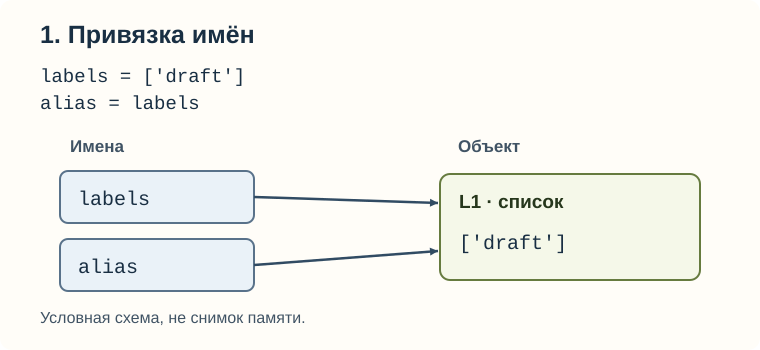
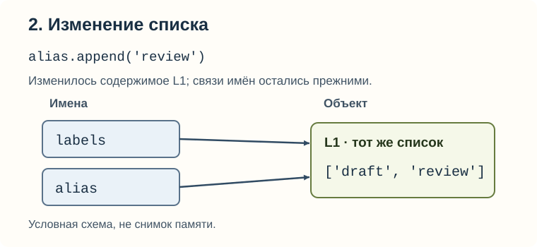
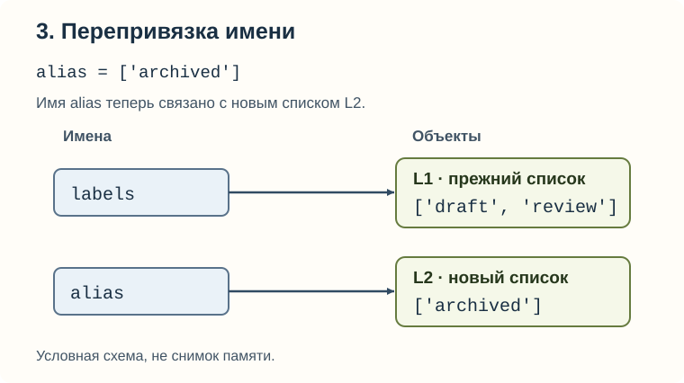
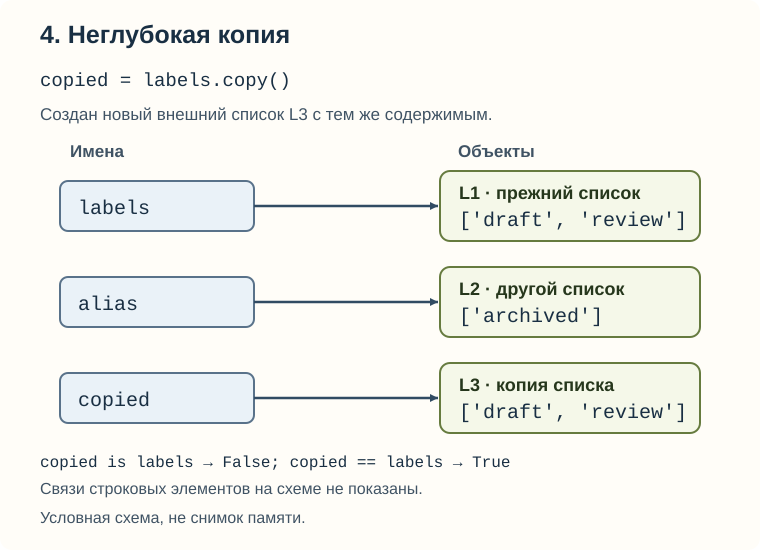

# Object Model: имя — не коробка с копией объекта

[Вход в урок и команды](README.md) · [Запускаемый пример](example.py)

## 1. Сначала предсказание

У документа есть метки. Вы хотите посмотреть на них под другим именем:

```python
labels = ["draft"]
alias = labels
alias.append("review")
print(labels)
```

Прежде чем запускать, запишите: напечатается `['draft']` или
`['draft', 'review']`? Почему? Это проверка № 1; ответ разберём по шагам ниже.

Минимум синтаксиса: `"draft"` — строка (string), то есть текстовое значение.
`["draft"]` — список (list) с одним элементом; запятые разделяют элементы,
`[]` обозначает пустой список. `append(...)` добавляет один элемент в конец
существующего списка. `print(...)` выводит значения. Кавычки в выводе списка
помогают распознать строки; одинарные и двойные кавычки здесь не меняют их смысл.

Причина неожиданности не в метках документа. Та же ситуация возникает,
когда две части программы используют общий список настроек или задач.
Если считать, что присваивание обязательно создаёт копию, изменение через
`alias` будет казаться необъяснимым. Нам нужна другая модель.

## 2. Имена отдельно, объекты отдельно

Представьте список как карточку с содержимым, а `labels` — как подписанный
указатель на эту карточку. Запись `alias = labels` добавляет второй указатель,
а не вторую карточку. Теперь есть два способа обратиться к одному списку.

В этой модели **имя (name)** — обозначение вроде `labels` в коде.
**Объект (object)** — конкретное значение во время работы программы: например,
этот список. У объекта есть тип и собственная идентичность; его содержимое
может допускать изменение. **Привязка (binding)** — связь имени с объектом.
На схемах эта связь показана стрелкой. Говоря «ссылка (reference)», здесь будем
иметь в виду такую возможность обратиться к объекту, а не копию его данных.

**Присваивание (assignment)** имени выполняется в два смысловых шага:
сначала вычислить правую часть, затем связать имя слева с полученным объектом.
В `labels = ["draft"]` правая часть создаёт список. В `alias = labels`
правая часть находит уже существующий список. Сам знак `=` не приказывает
копировать его. Это правило для присваивания имени; формы вроде `items[0] = ...`
могут изменять контейнер и подробно появятся в Collections.

Схемы ниже — условные связи, **не снимки памяти**. `L1`, `L2`, `L3` — удобные
метки объектов только в объяснении, не Python-переменные и не адреса.
Строковые элементы тоже являются объектами, но их отдельные стрелки опущены:
сейчас нас интересует, сколько именно списков существует и какие имена их обозначают.
Основание модели: [Python Tutorial, §9.1 и §9.2](https://docs.python.org/3.12/tutorial/classes.html#a-word-about-names-and-objects).

## 3. Один пример, четыре состояния

### Шаг 1. Два имени, один список

После `labels = ["draft"]` появляется L1, после `alias = labels` второе имя
связывается с L1. Ситуация «несколько имён для одного объекта» называется
**алиасингом (aliasing)**. Это обычное совместное использование, не ошибка само по себе.



Текстовая версия: `labels → L1 ← alias`; содержимое L1 — `['draft']`.
`labels is alias` даёт `True`: оба имени ведут к одному объекту.
`True` и `False` — логические значения (boolean values), «истина» и «ложь».

### Шаг 2. Меняется объект, не стрелки

`alias.append("review")` находит L1 через имя `alias` и добавляет элемент
в этот список. Имя `labels` всё ещё ведёт к L1, поэтому через него видно
`['draft', 'review']`. Это **изменение объекта (mutation)**.



Текстовая версия: `labels → L1 ← alias`; L1 теперь `['draft', 'review']`.
Это ответ на первый прогноз. Python не синхронизировал две копии: копия вообще
не создавалась. Менялся единственный общий список.

### Шаг 3. Меняется одна стрелка

`alias = ["archived"]` сначала создаёт новый список L2. Затем имя `alias`
связывается с ним вместо L1. Такая замена связи называется
**перепривязкой (rebinding)**. L1 не изменился: `labels` по-прежнему обозначает его.



Текстовая версия: `labels → L1 ['draft', 'review']`; `alias → L2 ['archived']`.
`labels is alias` теперь `False`. Ошибочный прогноз «у labels тоже archived»
путает связь имени с содержимым объекта. Перепривязка `alias` не переписывает `labels`.

### Шаг 4. Отдельный список с равным содержимым

`copied = labels.copy()` создаёт новый внешний список L3 с теми же элементами
и связывает с ним имя `copied`. Это **неглубокая копия (shallow copy)**:
копируется контейнер, но его элементы не копируются рекурсивно.



Текстовая версия: `labels → L1`, `alias → L2`, `copied → L3`.
L1 и L3 оба содержат `['draft', 'review']`. Поэтому `copied is labels`
даёт `False`, а `copied == labels` — `True`. Отдельность и равенство
отвечают на разные вопросы — подробнее в разделе 5.

После следующей строки `copied.append("done")` меняется только L3.
Это шаг 5 проверки, без новой схемы: `labels` остаётся `['draft', 'review']`,
а `copied` становится `['draft', 'review', 'done']`.

| Шаг | Имена → объекты | Содержимое объектов | Наблюдение |
| --- | --- | --- | --- |
| 1 | labels, alias → L1 | L1: `['draft']` | Общий список; `is` → `True` |
| 2 | labels, alias → L1 | L1: `['draft', 'review']` | Изменение видно через оба имени |
| 3 | labels → L1; alias → L2 | L1: `['draft', 'review']`; L2: `['archived']` | Перенаправлена только связь alias |
| 4 | labels → L1; alias → L2; copied → L3 | L1 и L3: `['draft', 'review']`; L2 без изменений | L3 отдельный, но равный L1 |
| 5 | Те же связи | L3: `['draft', 'review', 'done']`; L1 и L2 без изменений | Изменение копии не добавляет элемент в оригинал |

<a id="run"></a>

## 4. Прогноз → запуск → объяснение → одна вариация

Ниже весь основной фрагмент из `main()` в [example.py](example.py).
`main()` — обёртка, позволяющая тестам запускать пример; знакомство с функциями
можно оставить соответствующему уроку. Каждая строка `print` выводит номер шага,
затем именно перечисленные в ней значения через пробел.

```python
labels = ["draft"]
alias = labels
print("1:", labels, alias, labels is alias)

alias.append("review")
print("2:", labels, alias, labels is alias)

alias = ["archived"]
print("3:", labels, alias, labels is alias)

copied = labels.copy()
print("4:", copied, copied is labels, copied == labels)

copied.append("done")
print("5:", labels, copied)
```

Запишите пять строк вывода до запуска. Выполните из корня репозитория:

```powershell
uv run --offline --no-sync python modules/01_python_core/01_object_model/example.py
```

Флаг `--no-sync` использует уже установленное окружение, `--offline` запрещает
сетевое обращение uv. Если окружения ещё нет, сначала выполните настройку
из [Environment](../00_environment/README.md). Сам пример использует только Python.

Полный ожидаемый вывод файла:

```text
same object=False; same value=True
1: ['draft'] ['draft'] True
2: ['draft', 'review'] ['draft', 'review'] True
3: ['draft', 'review'] ['archived'] False
4: ['draft', 'review'] False True
5: ['draft', 'review'] ['draft', 'review', 'done']
missing: True False
empty: False False
present: False True
text: False True
```

Первая строка сохранена от прежней демонстрации `compare_ticket_tags()`:
два отдельных списка `['billing', 'urgent']` равны по содержимому, но не являются
одним объектом. Шаги 1–5 объяснены таблицей; последние четыре строки разберём
в разделе 7. Это полный вывод, а не только удачные выбранные строки.

Проверка № 2: что изменится, если **только** `alias = labels` заменить на
`alias = labels.copy()`? В отдельной Python Console можно выполнить вариацию:

```python
labels = ["draft"]
alias = labels.copy()
alias.append("review")
print(labels, alias, labels is alias)
```

<details>
<summary>После своего прогноза: результат и причина</summary>

Результат: `['draft'] ['draft', 'review'] False`. Уже на первом шаге два списка,
поэтому добавление через `alias` не меняет `labels`. Если заменить строку в полном
основном фрагменте, шаг 1 покажет `False`; шаг 2 — разные содержимые; после шага 3
у `labels` останется только `draft`, и именно его скопирует шаг 4.
Не меняйте эталонный `example.py` ради вариации: его проверяют тесты демонстрации.

</details>

## 5. Identity, equality и изменяемость

В шаге 4 два списка выглядели одинаково, но были отдельными. **Идентичность
(identity)** отвечает на вопрос «тот же самый объект?», её сравнивает `is`.
**Равенство (equality)** отвечает на вопрос, считаются ли значения равными по
правилам их типа. У наших списков строк `==` сравнивает длину и попарно элементы
в одинаковом порядке. Поэтому два списка могут быть равны без общей идентичности.
Не переносите это определение `==` без оговорок на любой пользовательский класс:
тип может задавать собственное сравнение.

Сравнивать содержимое строк или числа через `is` нельзя. Возможное повторное
использование объектов интерпретатором не является правилом сравнения значений.
Нам не нужны `id(...)`, адреса, кеширование или устройство сборщика мусора.
См. точную [модель объектов Python, §3.1](https://docs.python.org/3.12/reference/datamodel.html#objects-values-and-types).

Почему `append` вообще может изменить список? Список относится к
**изменяемым (mutable)** типам: содержимое можно изменить, сохранив тот же объект.
Таковы также словари (`dict`) и множества (`set`). **Неизменяемый (immutable)**
объект нельзя изменить на месте: числа (`int`, `float`), строки (`str`),
логические значения (`bool`) и кортежи (`tuple`) относятся к этой группе.
Перепривязать имя можно в обоих случаях — изменяемость является свойством
объекта, а не запретом на новое присваивание имени.

```python
title = "draft"
old_title = title
title = title + "!"
print(title, old_title)
```

Вывод `draft! draft`: операция `+` дала строку с новым значением, затем
`title` перепривязалось; прежняя строка через `old_title` не изменилась.
Нельзя рассуждать так: «имя осталось прежним, значит объект изменился».
И наоборот, для списка `append` изменяет объект без новой привязки имени.
Не делайте пока общего вывода о `+=`: его поведение зависит от типа.

<details>
<summary>Необязательно: где заканчивается независимость shallow copy</summary>

```python
pages = [["draft"]]
copied_pages = pages.copy()
copied_pages[0].append("review")
print(pages, copied_pages, pages is copied_pages)
print(pages[0] is copied_pages[0])
```

Вывод:

```text
[['draft', 'review']] [['draft', 'review']] False
True
```

Здесь `[0]` выбирает первый элемент (индексация начинается с нуля).
Два внешних списка содержат ссылку на один внутренний список. `copy()`
не прошёл внутрь него, и `append` изменил общий внутренний объект.
У списка строк в основном примере нет вложенного изменяемого списка;
добавление элемента меняет только внешний контейнер. Однако и там строки
не копируются рекурсивно. Неизменяемый кортеж тоже может содержать изменяемый
список: неизменяемость кортежа не делает все вложенные объекты неизменяемыми.
Глубокое копирование сейчас не требуется; важно явно понимать границу владения.

</details>

## 6. Тип принадлежит объекту

Когда вы видите `labels`, по одному имени нельзя узнать, какие операции
допустимы. Это определяет **тип (type)** связанного с ним объекта. У списка
есть `append`, у целого числа — нет. **Динамическая типизация (dynamic typing)**
не означает отсутствие типов или автоматическое превращение любого значения
в нужное: операции проверяются с фактическими объектами во время выполнения.

```python
value = 1
print(type(value).__name__)
value = "one"
print(type(value).__name__)
```

Вывод `int`, затем `str`, каждый на своей строке. Здесь `type(...)` узнаёт тип,
а `.__name__` берёт его читаемое имя. Число не превратилось в строку:
имя `value` сначала обозначало один объект, затем другой. У рассматриваемых
встроенных объектов тип сохраняется. Если написать `1 + "one"`, Python выдаст
`TypeError`, а не склеит текст с числом автоматически.

**Подсказка типа (type hint)** сообщает намерение читателю и инструментам:
например, `count: int = 3`. Она полезна для поиска ошибок редактором и mypy,
но сам Python не превращает её в проверку значения при каждом присваивании.
Показательный намеренно некорректный с точки зрения type checker фрагмент:

```python
count: int = 3
count = "three"
print(count)
```

Интерпретатор напечатает `three`; статический анализатор должен сообщить
о несовместимом присваивании. Не переносите этот фрагмент в рабочую реализацию
для обхода mypy. Проверка входных данных во время выполнения — отдельный код
или инструмент, а не следствие наличия аннотации.
См. [typing: назначение подсказок типов](https://docs.python.org/3.12/library/typing.html).

## 7. None: значение отсутствует или оно пустое?

Представьте загрузку меток: «ответ ещё не получен» и «получен список без меток» —
разные состояния. Договоримся в этом примере обозначать первое через `None`,
второе через `[]`. Это смысл, выбранный программой, а не встроенное знание
Python о загрузках.

`None` — специальный единственный объект (**singleton**), часто обозначающий
отсутствие значения. Это не пустой список, не ноль, не необъявленное имя.
Проверка `value is None` спрашивает именно об этом объекте. Для отсутствия
используйте её, а не общее сравнение `==`, поведение которого может задавать тип.

**Истинность в условии (truthiness)** — другой вопрос: как значение ведёт себя
в `if`. `bool(value)` показывает этот логический результат. Для встроенных
значений `None`, `False`, нуля и пустых контейнеров он `False` (falsey);
для непустых списков и строк — `True` (truthy). Это правило не является
валидатором бизнес-смысла значения. Непустая строка `"False"` тоже truthy.

Последний фрагмент `example.py`:

```python
missing = None
empty: list[str] = []
present = ["draft"]
text = "False"
print("missing:", missing is None, bool(missing))
print("empty:", empty is None, bool(empty))
print("present:", present is None, bool(present))
print("text:", text is None, bool(text))
```

`list[str]` в аннотации означает «ожидается список строк»; пустой список этому
не противоречит. Сравните два вопроса в каждой строке:

| Значение | `is None` | `bool(...)` | Смысл в примере |
| --- | --- | --- | --- |
| `None` | `True` | `False` | Нет результата |
| `[]` | `False` | `False` | Результат есть, меток нет |
| `["draft"]` | `False` | `True` | Есть метка |
| `"False"` | `False` | `True` | Непустой текст, не логическое False |

Проверка № 3: загрузка вернула `[]`. Можно ли по `if not result` заключить,
что она не вернула значения? Сначала сформулируйте причину самостоятельно.

<details>
<summary>После своей попытки: условие и смысл</summary>

Нет. `not` меняет логическую истинность на противоположную, поэтому такое
условие сработает и для `[]`, и для `None`. Для различения отсутствия в нашем
договоре нужно `result is None`. `if result` уместно, когда намеренно спрашиваем
«есть ли элементы?» при известном типе списка, а не «получен ли результат?».
Это и есть осмысленный pythonic-стиль, не механическое сокращение записи.

</details>

Правила для встроенных типов: [Truth Value Testing](https://docs.python.org/3.12/library/stdtypes.html#truth-value-testing).
К пользовательским объектам не следует автоматически применять правило
«любой объект — True»: их тип может определять поведение в условии.

<a id="java"></a>

## 8. Что помогает опыт Java — и где меняются правила

В Java при `var alias = labels` для `ArrayList<String>` тоже не появляется
копия списка. `alias.add("review")` меняет общий объект; последующее присваивание
`alias = new ArrayList<>()` не очищает список, доступный через `labels`.
Это полезный перенос интуиции о совместном объекте, но не доказательство
совпадения моделей языков целиком.

| Вопрос | Python в нашем примере | Java для ссылок на списки |
| --- | --- | --- |
| Что делает `alias = labels`? | Связывает имя с тем же объектом | Копирует значение ссылки в переменную; список тот же |
| Один и тот же объект? | `a is b` | `a == b` для ссылок |
| Равное содержимое? | `a == b` для списков строк | `a.equals(b)` у `List`: равные элементы в том же порядке |
| Тип переменной | Нет обязательного объявления; у связанного объекта есть тип | У переменной есть тип времени компиляции, даже при `var` |
| Отсутствие | Объект `None`, проверка `is None` | Значение ссылки `null`, проверка `== null` |
| Пустой список в условии | `if items` проверяет истинность списка | Нужна boolean-проверка, например `!items.isEmpty()` после проверки null |

Тонкость типизации: Java-переменная типа `Object` может последовательно
ссылаться на объекты разных допустимых классов. Поэтому различие не в запрете
«никогда не менять класс объекта за именем», а в наличии объявленного ограничения
на тип переменной и проверке совместимости. Python type hints помогают проверять
намерение статически, но интерпретатор сам это ограничение не навязывает.
Java-примитивы и их сравнения не надо смешивать с обсуждением ссылок на `List`.

Точечные основания сравнения: [JLS §4, Types, Values, and Variables](https://docs.oracle.com/javase/specs/jls/se25/html/jls-4.html),
[JLS §15.21.3, Reference Equality Operators](https://docs.oracle.com/javase/specs/jls/se25/html/jls-15.html#jls-15.21.3),
[List.equals](https://docs.oracle.com/javase/8/docs/api/java/util/List.html#equals-java.lang.Object-).
Это ссылки для уточнения отдельных утверждений, не дополнительный маршрут Java.

<details>
<summary>После Functions: почему это не «передача по ссылке» без оговорок</summary>

При вызове функции её параметр становится локальным именем для переданного
объекта. Изменение общего списка внутри функции видно снаружи. Но присваивание
другого объекта локальному параметру не перенаправляет имя вызывающего кода.
Так мы описываем связи, а не предполагаем, что функция получила возможность
переписать переменную вызывающей стороны. Практику defaults оставьте
до [Functions](../03_functions/README.md); здесь это не prerequisite.

</details>

<a id="answers"></a>

## 9. Самопроверка после своей попытки

Вернитесь к семи вопросам в [README](README.md#self-check). Придумайте
новые значения и нарисуйте стрелки, прежде чем сверяться с ответами.

<details>
<summary>1–2. Имена, количество объектов и равенство</summary>

Два указанных имени ведут к одному списку; строка внутри — тоже объект,
но вопрос о числе списков. Присваивание второму имени создало связь, не копию.
Два отдельно созданных списка с равными строками могут дать `== True`
и `is False`. По одному равенству число списков установить нельзя.

</details>

<details>
<summary>3–4. Изменение, перепривязка и копия</summary>

Если имена ещё обозначают общий список, `append` виден через оба. Присваивание
нового списка меняет только связь `right`. `copy()` создаёт отдельный внешний
список: добавление элемента в него не добавляет элемент в оригинал.
Необязательное уточнение после заметки о вложенности: внутренний список может
оставаться общим; копия верхнего уровня не обещает полной независимости.

</details>

<details>
<summary>5. Отсутствие и пустота</summary>

Пары `(is None, bool)` соответственно: `(True, False)`, `(False, False)`,
`(False, True)`. Первые два значения одинаково ложны в условии, но только
первое означает отсутствие по нашему договору. Одной truthiness недостаточно.

</details>

<details>
<summary>6–7. Типы, Java и стиль</summary>

Перепривязалось имя, число не изменило свой тип. Подсказки типов используются
читателем и анализатором; сами по себе не валидируют runtime-значения.
Из Java переносится совместное использование изменяемого объекта, но не
значение `==` для ссылок, обязательная типизация переменной или правила условий.
Pythonic — выбирать конструкцию по смыслу: `is None` для отсутствия,
проверку истинности для намеренно объединяемых falsey-состояний.

</details>

<a id="practice"></a>

## 10. Переход к существующим заданиям

Сейчас завершите прогнозы и схемы. Затем идите по прежнему порядку в
[Collections](../02_collections/README.md), не перескакивая prerequisites.

- После Collections: [Filter and project event records](../02_collections/exercises/filter_project_events/README.md),
  ID `python-filter-project-events`. Это перенос на отбор записей и проверку
  входных полей, не переписанный пример меток. Объясните, почему пустой результат
  допустим, а подсказка типа не заменяет проверку данных. Тесты этого задания
  не являются отдельной проверкой усвоения aliasing.
- После Collections, Functions и урока 09 pytest:
  [Build a word index](../exercises/word_index/README.md), ID `python-word-index`.
  Здесь уже существенны неизменность входа и независимые равные результаты
  повторных вызовов. Перед реализацией объясните, где должен появиться новый
  контейнер. Решение и ученический `starter.py` не входят в демонстрацию.
- Необязательное возвращение после Functions:
  [Debug leaking audit tags](../03_functions/debugging/mutable_defaults/README.md),
  ID `python-debug-mutable-defaults`. Исследуйте общую изменяемую структуру
  между вызовами; правила значений аргументов по умолчанию изучайте там.

Команды для выбранной практики (после её prerequisites):

```powershell
uv run python scripts/learn.py test python-filter-project-events
uv run python scripts/learn.py check python-filter-project-events
```

Первую можно запускать для обратной связи во время работы; вторая требует
выполненных обязательных тестов именно этого задания. У нетронутого TODO
строгий зачёт не должен проходить. Чужие TODO не должны делать его глобально
красным. Для других заданий используйте их ID и инструкции README.
Ни запуск демонстрации, ни её тесты не меняют progress.

## 11. Два дополнительных ресурса и границы проверки

1. **Python Software Foundation / Python documentation — “9. Classes”,
   §9.1 “A Word About Names and Objects” и выбранные абзацы §9.2 “Python Scopes and Namespaces”.**
   [Точный вход в §9.1, Python 3.12](https://docs.python.org/3.12/tutorial/classes.html#a-word-about-names-and-objects).
   Язык: английский. Зачем: уточнить aliasing, соответствие имён объектам и
   отсутствие копирования при присваивании имени. Читайте после четырёх схем.
   В §9.2 достаточно определения namespace и абзаца о присваивании; остановитесь
   до §9.2.1. Классы, области видимости `global/nonlocal` и вся глава сейчас не нужны.
2. **Python Tutor — “Python Tutor — Python Online Compiler with Visual Debugger”.**
   [Страница проекта](https://pythontutor.com/), раздел “Visualize code execution”,
   переход “Start Visualizing”. Язык интерфейса: английский. Зачем: дополнительно
   увидеть выполнение строк и связи объектов. После локального запуска можно
   вручную ввести только маленький учебный фрагмент из раздела 4; остановитесь
   после пяти шагов и объясните, какой шаг менял объект, а какой — имя.
   Это необязательно: локальные схемы и код дают весь необходимый материал.

Проверка ссылок: **2026-10-02**, открытие страниц через веб-инструмент и чтение
соответствующих разделов. Основные ресурсы и точечные ссылки на Python/Java
доступны. Целевая ветка документации Python — 3.12, проверенный локальный
интерпретатор — 3.12.14; сайт отображает документацию 3.12.15. Среда ради этого
не обновлялась. Интерактивное выполнение в Python Tutor — **NOT_RUN**:
код и файлы репозитория туда не отправлялись. Доступность страницы не доказывает
работу всех функций сервиса. Не загружайте туда личные данные, проекты или секреты.

## 12. Где остановиться

Смысловые критерии — в [Done when](README.md#done-when). Умение пересказать
вывод не заменяет предсказание нового примера. Если без стрелок или с другими
значениями объяснение теряется, вернитесь к конкретному шагу, а не ко всему курсу.
Понятность этого пилота для вас ещё требует вашей обратной связи.

Следующие кандидаты только после оценки пилота: NumPy (shape/axis/broadcasting)
и математический мост (loss/градиент/chain rule). Здесь они не реализуются.
