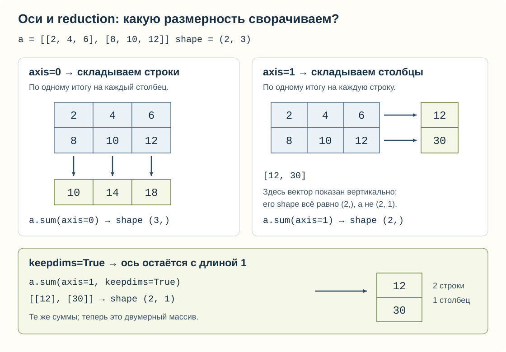
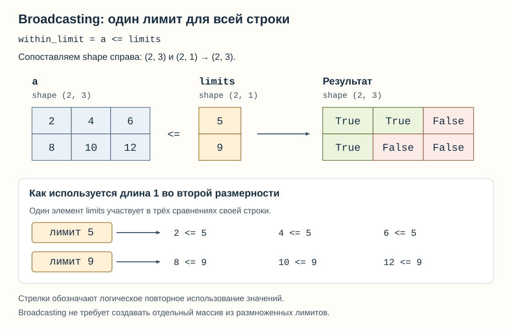
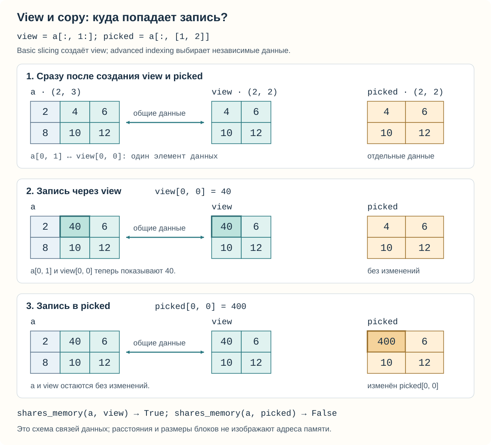

# NumPy: сначала форма, затем операция

[Вход в урок](README.md) · [Запускаемый разбор](walkthrough.py)

Предпосылки: [Object Model](../../01_python_core/01_object_model/README.md),
[Collections](../../01_python_core/02_collections/README.md),
[Functions](../../01_python_core/03_functions/README.md) и базовые аннотации
[Typing](../../01_python_core/04_typing/README.md). Это сопровождение существующего
`data-numpy`, не новый обязательный модуль. Весь пример локальный: никаких загрузок.
Проходите за три подхода: §1–3 → §4–5 → §6–9. Перед каждым запуском делайте прогноз.

## 1. От таблицы наблюдений к shape

Два датчика сделали по три измерения. Нам нужно сравнить каждое измерение с
порогом своего датчика. В списке списков мы обошли бы строки, а затем значения.
В NumPy сначала описываем расположение данных и затем применяем операцию ко всему
массиву. Пока не считайте байты или скорость: нарисуйте две строки по три клетки.

Прогноз: сколько здесь чисел, сколько направлений индексации и что обозначает
первое число в `(2, 3)`? Не называйте все три ответа «размером».

```pycon
>>> import numpy as np
>>> a = np.array([[2, 4, 6], [8, 10, 12]], dtype=np.int32)
>>> a.tolist()
[[2, 4, 6], [8, 10, 12]]
>>> a.shape, a.ndim, a.size
((2, 3), 2, 6)
```

Массив (array, `ndarray`) хранит элементы с одним описанием типа. **Форма (shape)** —
кортеж длин осей: сначала 2 строки, затем 3 столбца. **Ось (axis)** — одно направление
индексации; `ndim=2` означает две оси. **Число элементов (size)** — произведение длин:
`2 × 3 = 6`. NumPy не знает, что строки — датчики: этот смысл задаём мы.

В Java `int[][]` — массив ссылок на массивы; длины внутренних массивов могут
различаться. Здесь обычный числовой `ndarray` имеет прямоугольную форму и один
`dtype`. Python `list` также хранит ссылки на объекты, а не такой однородный
числовой буфер. Это не означает, что NumPy всегда нужен вместо списка.

Одномерная форма `(3,)` — три элемента и **одна** ось, не «строка матрицы» `(1, 3)`
и не «столбец» `(3, 1)`. Запятая делает `(3,)` кортежем из одного числа. В
`np.arange(6).reshape(2, 3)` сначала возникают числа от 0 до 5, затем те же шесть
элементов получают форму 2 × 3. `reshape` не добавляет элементы: произведение
новых длин должно совпасть с `size`; иногда нужен новый буфер (об этом §6).

Типичная ошибка: считать `len(a)` числом всех элементов. Здесь это только 2,
длина первой оси. Самостоятельная вариация: для трёх датчиков с двумя измерениями
запишите `shape`, `ndim`, `size`, а затем сравните с шестью числами в одном ряду.

## 2. Dtype: не только «какие числа», но и как они хранятся

Подумайте о клетке фиксированной ширины. Если каждая из шести клеток занимает
4 байта, полезная нагрузка массива равна 24 байтам. **Тип элемента (dtype)**
`int32` означает знаковое целое фиксированной 32-битной ширины. В отличие от
Python `int`, его диапазон ограничен; целочисленные операции могут переполняться.
`float64` — 64-битное число с плавающей точкой, не точная десятичная арифметика.

```pycon
>>> import numpy as np
>>> a = np.array([[2, 4, 6], [8, 10, 12]], dtype=np.int32)
>>> str(a.dtype), a.itemsize, a.nbytes
('int32', 4, 24)
>>> b = a + 0.5
>>> b.tolist(), str(b.dtype)
([[2.5, 4.5, 6.5], [8.5, 10.5, 12.5]], 'float64')
>>> a.tolist()
[[2, 4, 6], [8, 10, 12]]
```

По шагам: целочисленный вход не может хранить половину; **повышение типа (type
promotion)** этой операции выбирает `float64`; результат — другой массив, `a`
не изменён. Не обобщайте этот результат до «любое смешивание всегда даёт float64»:
правило зависит от конкретных типов операндов. `a.astype(np.float64)` явно создаёт
преобразованный массив (по умолчанию копию), а не меняет смысл исходного `a`.

Типичная ошибка: ожидать, что присваивание дроби в целочисленный массив сохранит
дробную часть. Прогноз и самостоятельная проверка: создайте отдельный `int32`
массив `[1, 2]`, присвойте первому элементу `1.9`, распечатайте значение и `dtype`.
Объясните разницу между записью в существующий буфер и вычислением `a + 0.5`.
Этот опыт — про потерю информации, не рецепт округления денежных величин.

## 3. Indexing: какие клетки выбраны и какие оси остались

Запись `a[строка, столбец]` задаёт две координаты, начиная с нуля. Двоеточие
`:` означает все позиции по данной оси. Срез (slice) `1:2` включает 1, но не 2.
Прогноз: будут ли одинаковы **значения и формы** `a[:, 1]` и `a[:, 1:2]`?

```pycon
>>> import numpy as np
>>> a = np.array([[2, 4, 6], [8, 10, 12]], dtype=np.int32)
>>> a[:, 1].tolist(), a[:, 1].shape
([4, 10], (2,))
>>> a[:, 1:2].tolist(), a[:, 1:2].shape
([[4], [10]], (2, 1))
>>> a[[0, 1], [1, 2]].tolist()
[4, 12]
>>> (a > 7).tolist()
[[False, False, False], [True, True, True]]
>>> a[a > 7].tolist(), a[a > 7].shape
([8, 10, 12], (3,))
```

В первом случае номер столбца фиксирован, поэтому его ось исчезает. Во втором
срез сохраняет ось длиной 1. Два списка индексов выбирают **пары координат**
`(0, 1)` и `(1, 2)`, не прямоугольник всех сочетаний. Булева маска (boolean mask)
имеет форму `a`, отмечает каждую клетку и при таком отборе выдаёт одномерную
последовательность подходящих значений в порядке обхода строк.

Типичная ошибка: ожидать двумерную таблицу после `a[a > 7]`. Значения выбраны, но
смысл «три измерения каждого датчика» уже не сохранён как две оси. Срезы массивов
и расширенная индексация (advanced indexing: списки целых индексов или маски)
ещё и по-разному обращаются с памятью — это эксперимент §6.

Самостоятельно: предскажите значения и форму `a[1, :]`, `a[1:2, :]`,
`a[[0, 1], [2, 0]]` и `a[a % 4 == 0]`. Запишите четыре прогноза, затем проверьте.
Ошибка прогноза полезна, если вы можете указать правило, которое перепутали.

## 4. Axis: какую ось сворачивает reduction

Чтобы получить сумму каждого момента измерения по датчикам, складываем клетки
одного столбца. Чтобы получить сумму каждого датчика, складываем его строку.
Это два разных вопроса к одной таблице. **Свёртка (reduction)**, например `sum`,
убирает выбранную ось; номер оси не является командой «посчитать такую строку».



Прогноз: какая форма останется, если убрать из `(2, 3)` сначала ось 0, затем ось 1?

```pycon
>>> import numpy as np
>>> a = np.array([[2, 4, 6], [8, 10, 12]], dtype=np.int32)
>>> a.sum(axis=0).tolist(), a.sum(axis=0).shape
([10, 14, 18], (3,))
>>> a.sum(axis=1).tolist(), a.sum(axis=1).shape
([12, 30], (2,))
>>> a.sum(axis=1, keepdims=True).tolist(), a.sum(axis=1, keepdims=True).shape
([[12], [30]], (2, 1))
```

Первая сумма: `2+8`, `4+10`, `6+12`; ось строк исчезла. Вторая: `2+4+6` и
`8+10+12`; ось столбцов исчезла. **Сохранение измерений (keepdims)** оставляет на
месте свёрнутой оси длину 1. Это особенно удобно для следующей поэлементной
операции, где важно не перепутать строку и столбец.

Типичная ошибка: читать `axis=0` как «сумма нулевой строки». Для выбора строки
нужен индекс `a[0]`; для суммирования вдоль оси — аргумент `axis`.
Самостоятельно замените `sum` на `mean`, предскажите оба результата и формы
до выполнения. Потом объясните смысл получившегося среднего словами о датчиках.

## 5. Broadcasting и vectorization: сначала совместимость

У первого датчика порог 5, у второго 9. Хотим сравнить три значения каждой строки
с одним порогом этой строки. **Трансляция форм (broadcasting)** позволяет применять
операцию к совместимым формам без ручного заполнения одинаковых порогов.

Формы сопоставляются **справа налево**. Пара длин совместима, если они равны
или одна равна 1; отсутствующая слева ось считается длиной 1. Итоговая длина
для этих непустых осей — большая из двух. Это правило размещения, не догадка
NumPy о смысле данных.



`np.array([5, 9])` имеет форму `(2,)`. `[:, np.newaxis]` сохраняет первую ось и
добавляет вторую длиной 1: `[[5], [9]]`. `np.newaxis` в индексе — другое имя для
`None`; оно не означает пропущенное наблюдение. Получаем сопоставление:

| Операнд | Ось 0 | Ось 1 |
| --- | --- | --- |
| Измерения | 2 | 3 |
| Пороги | 2 | 1 |
| Результат | 2 | 3 |

Прогноз: где окажется `False`? Что произойдёт, если не добавить ось порогам?

```pycon
>>> import numpy as np
>>> a = np.array([[2, 4, 6], [8, 10, 12]], dtype=np.int32)
>>> limits = np.array([5, 9], dtype=np.int32)[:, np.newaxis]
>>> (a <= limits).tolist()
[[True, True, False], [True, False, False]]
>>> loop_result = [[value <= limit for value in row] for row, limit in zip(a, [5, 9], strict=True)]
>>> bool(np.array_equal(a <= limits, loop_result))
True
```

Сначала 2, 4, 6 сравниваются с 5, затем 8, 10, 12 с 9. Вариант без новой оси
пытается совместить справа 3 и 2; обе длины не равны 1, поэтому получаем
`ValueError`, а не автоматический поворот. `walkthrough.py` ловит эту ожидаемую
ошибку и печатает короткое пояснение вместо зависящего от версии текста NumPy.

**Векторизация (vectorization)** здесь — выражение операции над всем массивом
вместо Python-цикла для каждой клетки. Цикл выше — объяснение эквивалентности,
не «эталон решения» student-задачи. Внутри NumPy вычисления всё равно обходят
элементы. Ни отсутствие `for`, ни совпадение результатов не доказывают ускорение:
нужны измерения на реальных размерах, а промежуточные массивы могут стоить памяти.

Типичная ошибка: исправить форму, не проверив смысл. При квадратном входе
неверно ориентированные пороги могут случайно пройти проверку совместимости.
Самостоятельно сравните новый массив формы `(3, 2)` с тремя порогами строк и
двумя порогами столбцов. Сначала нарисуйте формы. Проверьте и значения, и форму;
объясните, почему правильная форма сама по себе не гарантирует правильную логику.

Существующий [example.py](example.py) решает соседнюю задачу: четыре времени ответа
формы `(4,)` сравниваются с двумя SLA формы `(2, 1)`. Недостающая слева ось времён
считается единицей; результат `(2, 4)` равен
`[[True, False, False, False], [True, True, True, False]]`. Это таблица «каждый SLA ×
каждое время», а не «свой порог каждой строки», как в нашем примере.

## 6. View/copy: другой объект не всегда другой буфер

Из [Object Model](../../01_python_core/01_object_model/theory.md) известно, что
`alias = a` связывает ещё одно имя с тем же объектом. NumPy добавляет возможность:
**представление (view)** — другой объект массива, который смотрит на прежние
данные. **Копия (copy)** данных имеет отдельный буфер. Для наших числовых массивов
запись в независимую копию не меняет исходник.



Прогноз: после двух записей ниже в исходнике появится 40, 400, оба числа или ни одно?

```pycon
>>> import numpy as np
>>> a = np.array([[2, 4, 6], [8, 10, 12]], dtype=np.int32)
>>> view = a[:, 1:]
>>> picked = a[:, [1, 2]]
>>> copied = a.copy()
>>> np.shares_memory(a, view), np.shares_memory(a, picked), np.shares_memory(a, copied)
(True, False, False)
>>> view[0, 0] = 40
>>> a.tolist()
[[2, 40, 6], [8, 10, 12]]
>>> picked[0, 0] = 400
>>> a.tolist(), picked.tolist(), copied.tolist()
([[2, 40, 6], [8, 10, 12]], [[400, 6], [10, 12]], [[2, 4, 6], [8, 10, 12]])
```

Срез `1:` выбирает столбцы 1 и 2 без копирования их данных: координата
`view[0, 0]` соответствует `a[0, 1]`. Список `[1, 2]` при чтении включает advanced
indexing и копирует выбранные данные. Явный `copy()` сохраняет все исходные
значения до изменений. `is` проверил бы объекты, но не общую память; для этих
малых примеров её проверяет `np.shares_memory`.

Правило «срез массива даёт view» относится к результату-массиву. `a[0, 0]` возвращает
скаляр NumPy, не двумерное представление. И не путайте чтение `picked = a[mask]`
с записью `a[mask] = value`: вторая форма изменяет выбранные клетки самого `a`.

У `reshape` нет обещания всегда обойтись без копии. Например:

```pycon
>>> import numpy as np
>>> grid = np.arange(12, dtype=np.int32).reshape(3, 4)
>>> grid.T.tolist()
[[0, 4, 8], [1, 5, 9], [2, 6, 10], [3, 7, 11]]
>>> flattened = grid.T.reshape(12)
>>> flattened.tolist()
[0, 4, 8, 1, 5, 9, 2, 6, 10, 3, 7, 11]
>>> np.shares_memory(grid, flattened)
False
```

`.T` меняет местами оси: бывшие столбцы читаются как строки. После этого
превратить приведённый порядок обхода в одну ось только изменением метаданных
не получается; в данном примере `reshape` копирует данные. Не нужно пока учить
все правила strides: важно проверять предположение об общей памяти, а не делать
его по имени метода. Детали: [Copies and views](https://numpy.org/doc/2.5/user/basics.copies.html).

Типичная ошибка: считать `a[:]` независимым снимком по аналогии с Python-списком.
Самостоятельно замените срез на `a[:, 1:].copy()`, повторите запись другого числа
и объясните, какой результат изменился. Затем объясните, почему одна проверка
равенства значений не выявила бы различие **до** записи.

## 7. Малый эксперимент: сколько памяти вы действительно считаете

Если представить broadcast как физически размноженные строки, легко неправильно
оценить память. Поэтому отдельно посчитаем логический объём элементов и отдельно
проверим общую память. **`nbytes`** — `size × itemsize`, без служебных данных объекта,
не измерение всей памяти процесса или её пика.

В `walkthrough.py` после предыдущих операций печатаются:

| Объект | Логический объём | Отдельные данные относительно `a` |
| --- | --- | --- |
| `a`, шесть `int32` | 24 байта | исходный буфер |
| `view`, четыре `int32` | 16 байт | нет, это часть `a` |
| `copied` | 24 байта | да |
| `mask`, шесть `bool` | 6 байт | да |
| `selected`, три `int32` | 12 байт | да, отбор по маске |

Сложить `a.nbytes + view.nbytes` и объявить 40 выделенных байт было бы двойным
учётом общих данных. View также удерживает исходный буфер: маленькое представление
не гарантирует освобождение большого родителя. Для реальной оценки нужны ещё
временные результаты, служебные структуры и наблюдение за процессом.

Прогноз до запуска: может ли у представления быть больше `nbytes`, чем у исходника?

```pycon
>>> import numpy as np
>>> a = np.array([[2, 4, 6], [8, 10, 12]], dtype=np.int32)
>>> repeated = np.broadcast_to(a[0], (1000, 3))
>>> repeated.shape, repeated.nbytes, np.shares_memory(a, repeated), repeated.flags.writeable
((1000, 3), 12000, True, False)
>>> offset = a + 10
>>> offset.nbytes, np.shares_memory(a, offset)
(24, False)
>>> 1000 * 1000 * np.dtype(np.float64).itemsize
8000000
```

`broadcast_to` возвращает представление только для чтения: множество логических
позиций использует одни данные. Здесь нет нового буфера из 3000 чисел. Но обычная
операция `a + 10` создаёт результат; выражение с несколькими операциями может
создать несколько временных массивов. Последняя строка оценивает миллион
`float64`: 8 MB (примерно 7.63 MiB), **не выделяя** этот массив. Справка:
[`nbytes`](https://numpy.org/doc/2.5/reference/generated/numpy.ndarray.nbytes.html)
и [`broadcast_to`](https://numpy.org/doc/2.5/reference/generated/numpy.broadcast_to.html).

Самостоятельный опыт: в отдельном черновике поменяйте `int32` на `float64` и
`(1000, 3)` на `(10, 3)`. До запуска запишите ожидаемые `itemsize`, `nbytes`,
`shares_memory` и возможность записи. Сравните с выводом. Затем **только на бумаге**
оцените один массив `(200_000, 300)` из `float64` и ещё два таких промежуточных
результата при одновременно живом входе. Поместится ли это в бюджет 1 GiB?
Не выделяйте эти массивы ради проверки арифметики.

Критерий понимания: вы отличаете объём данных от пиковой памяти и можете предложить
обработку порциями (chunks), если полная операция не помещается. Полноценный
pipeline уже изучается позже в [data release](../exercises/data_release/README.md);
не начинайте его до Python I/O/generators/testing и data quality.

## 8. Собрать цепочку и перейти к практике

Из корня репозитория, после обычной установки окружения проекта:

```powershell
uv run --offline --no-sync python modules/03_data_foundations/01_numpy/walkthrough.py
uv run --offline --no-sync python modules/03_data_foundations/01_numpy/example.py
```

Первый файл выполняет разобранную цепочку в порядке урока. Начало вывода —
`array: [[2, 4, 6], [8, 10, 12]]`, затем метаданные и индексация; середина — суммы
и сравнение с порогами; после `sharing` происходят две записи; последние строки —
объёмы. Последняя строка: `offset_payload: 24 bytes, shares=False`. Значения
сверяются в [тестах демонстрации](../tests/test_numpy_walkthrough.py).
Маска/отбор вычислены **до** изменения `a`; это сохранённые результаты, они
не пересчитываются сами. Все `pycon`-блоки выше независимы: начинаются с своего
импорта и данных, поэтому их можно запускать отдельно.

Практика остаётся существующей:

- [Payment matrix](exercises/payment_matrix/README.md), `data-payment-matrix`:
  shape/dtype, broadcasting и отсутствие изменения входа. Предметная область
  контракта сохранена; демонстрация не подставляет за вас его решение.
- [Image pooling](../exercises/image_pooling/README.md), `data-image-pooling`:
  переход к четырём осям, reduction и независимость результата. Сначала устно
  назовите смысл каждой оси; векторизованный способ проверяется также вручную.
- [Существующий notebook](../notebooks/01_numpy_payment_arrays.ipynb) — необязательный
  дополнительный формат со своими TODO; он не нужен для запуска нового разбора.

После своей реализации запускайте строгий зачёт **выбранного** задания:

```powershell
uv run --offline --no-sync python scripts/learn.py test data-payment-matrix
uv run --offline --no-sync python scripts/learn.py check data-payment-matrix
```

`test` допускает ожидаемо незавершённые student tests; `check` требует реального
выполнения выбранного задания. Запуск teacher-примера не подтверждает ваше умение
и не меняет progress. Отдельные прогнозы indexing/dtype/memory оцениваются вручную;
новый автоматический зачёт для них не заявлен. Ученический отчёт здесь не заполнен.

## 9. Проверка понимания и внешнее объяснение

Вернитесь к [вопросам README](README.md#self-check). Для каждого ответа покажите
**новый** маленький пример. Минимум: предсказать форму, объяснить одну ошибку
совместимости, отличить view от copy после записи и оценить память без выделения.

<details><summary>Ориентиры для самопроверки — после своей попытки</summary>

1. `(2, 3)` — длины двух осей; `size=6`, но `len=2`.
2. `dtype` ограничивает представление и влияет на объём; Python `int` не равен `int32`.
3. Индекс убирает ось, срез сохраняет; два списка индексов задают пары координат.
4. `axis=0` сворачивает первую ось; `keepdims` оставляет её длиной 1.
5. `(2,)` не совпадает справа с `(2, 3)`; `(2, 1)` совпадает.
6. View разделяет данные; advanced indexing при чтении копирует выбранные данные.
7. Векторизация переносит цикл в операции над массивом, не обещает отсутствие памяти.
8. `nbytes` не учитывает весь процесс и повторно считает общие элементы разных view.

Это ориентиры объяснения, не ответы к упражнениям или самостоятельному большому
расчёту. Совпадение вывода без понимания причин ещё не критерий освоения.

</details>

Официальная документация NumPy 2.5, английский; страницы открыты 2026-10-04:

1. [Indexing on ndarrays](https://numpy.org/doc/2.5/user/basics.indexing.html):
   прочитайте Single element indexing, Slicing, затем примеры integer/Boolean
   indexing. Остановитесь до комбинирования множества advanced indices.
   Вопрос после чтения: чем одна координата отличается от среза длиной 1?
2. [Broadcasting](https://numpy.org/doc/2.5/user/basics.broadcasting.html):
   General broadcasting rules и простые совместимые/несовместимые формы.
   Остановитесь до больших многомерных примеров; нарисуйте собственную пару форм.
3. [Copies and views](https://numpy.org/doc/2.5/user/basics.copies.html):
   определения, Indexing operations и Other operations (`reshape`).
   После чтения докажите на малом примере, почему равенства значений недостаточно.

Дальнейшие темы — `dot`/геометрия и gradient bridge — остаются в существующем
маршруте; этот урок не превращается в отдельный курс линейной алгебры.
