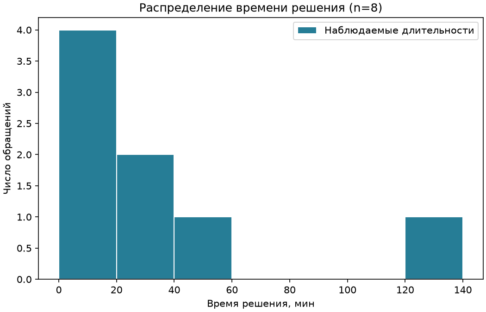
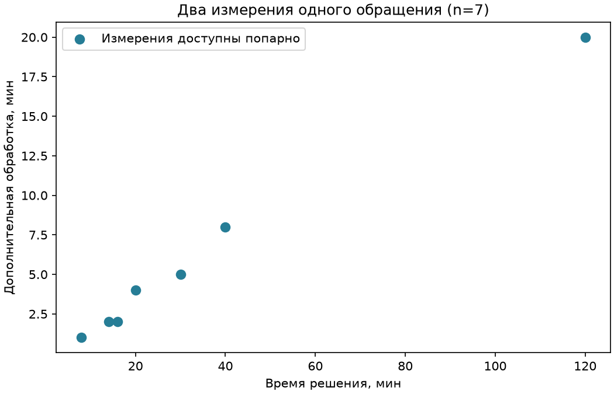
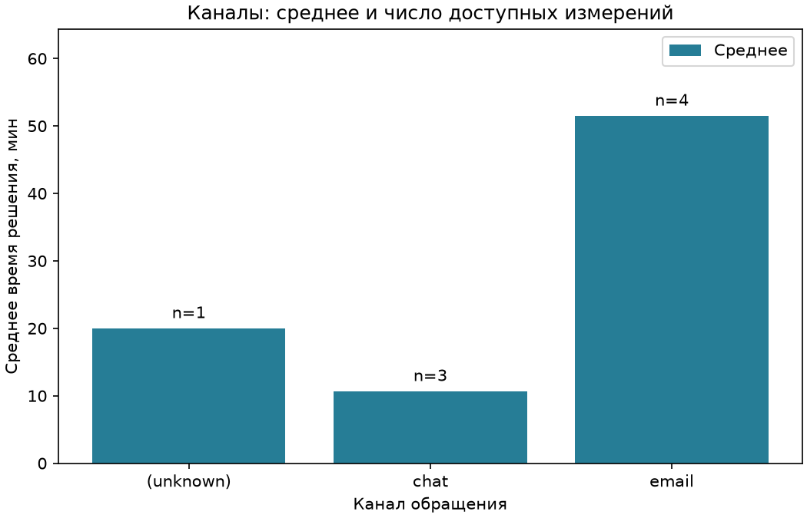
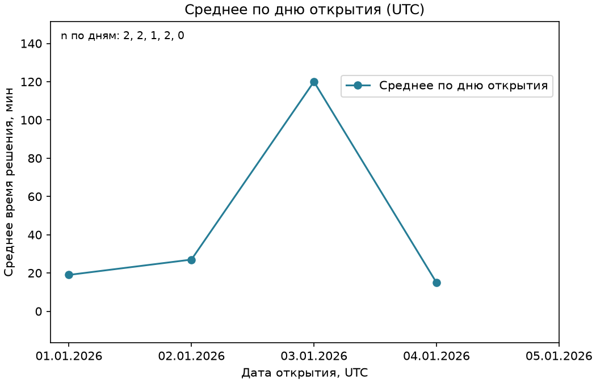

# EDA: от вопроса к проверяемому наблюдению

[Вход в урок](README.md) · [Качество данных](theory.md) · [Код демонстрации](eda_demo.py)

Это продолжение `data-quality`, не новый ID и не урок обучения модели.
Предпосылки: [Pandas](../02_pandas_core/theory.md), особенно маски, группировки,
пропуски и даты. Среднее и устройство графиков объясняются здесь; будущие
статистические и ML-модули для старта не требуются.

Пройдите разделы 1–3 без графиков, запишите прогнозы, затем 4–8 с запуском.
В конце перенесите подход на [погодный практикум](../exercises/weather_quality/eda_practice.md).
Каждый блок `pycon` — отдельный сеанс Python из корня репозитория.

## 1. Сначала вопрос, а не команда построения графика

Есть журнал обращений в поддержку. Хотим понять: «Какие длительности решения
встречаются в этой выгрузке и насколько отличаются доступные группы?» Сразу
рисовать среднее опасно: повторная строка даст одному обращению лишний вес,
текст `"bad"` не станет длительностью, а неизвестный канал исчезнет при обычном
`groupby`. До картинки нужны единица строки и правила включения.

**Разведочный анализ данных (exploratory data analysis, EDA)** — последовательное
изучение набора: вопрос → схема и качество → распределения и группы →
наблюдение → ограничения и следующий вопрос. Это не механическое получение
всех возможных графиков и не доказательство причины увиденного различия.

Здесь одна строка должна описывать одно обращение; `ticket_id` — его ключ.
Источник полностью вымышленный. Первые четыре обращения взяты из неизменённого
[примера Pandas](../02_pandas_core/example.py), затем добавлены даты,
дополнительное время обработки и учебные дефекты. В реальной работе нужно
уточнить, включает ли журнал незавершённые обращения; наш небольшой пример
не позволяет судить о всей работе службы поддержки.

| Поле | Что означает | Ожидание для этой демонстрации |
| --- | --- | --- |
| `ticket_id` | Идентификатор обращения | Непустой и уникальный после устранения точных повторов |
| `channel` | Канал поступления | Категория; неизвестное значение сохраняем отдельно |
| `opened_day` | День открытия | Календарный день; для вычислений принимаем UTC |
| `resolution_minutes` | Длительность решения | Конечное число ≥ 0, минуты |
| `followup_minutes` | Дополнительная обработка | Конечное число ≥ 0, минуты; отдельное измерение |

Типичная ошибка: выбрать `dropna()` до вопроса и удалить обращение с известной
длительностью только потому, что неизвестен канал. Вариация: сформулируйте,
какие поля нужны для распределения длительности, а какие — для изменения
среднего по дням. Совпадут ли необходимые столбцы?

## 2. Маленький источник и журнал решений

В таблице `—` обозначает исходный `None`, а не строку с тире. Числовые значения
пока текстовые. Это **вход**, не готовая таблица для графиков.

| Позиция | ticket_id | channel | opened_day | resolution_minutes | followup_minutes |
| ---: | --- | --- | --- | ---: | ---: |
| 0 | S-101 | chat | 2026-01-01 | 8 | 1 |
| 1 | S-102 | email | 2026-01-01 | 30 | 5 |
| 2 | S-103 | chat | 2026-01-02 | 14 | 2 |
| 3 | S-104 | email | 2026-01-02 | 40 | 8 |
| 4 | S-105 | chat | 2026-01-03 | — | 3 |
| 5 | S-106 | email | 2026-01-03 | 120 | 20 |
| 6 | S-107 | chat | 2026-01-04 | 10 | — |
| 7 | S-108 | — | 2026-01-04 | 20 | 4 |
| 8 | S-109 | email | bad-date | 16 | 2 |
| 9 | S-110 | chat | 2026-01-05 | -3 | 1 |
| 10 | S-104 | email | 2026-01-02 | 40 | 8 |
| 11 | S-111 | email | 2026-01-05 | bad | 6 |

**Прогноз.** Удалим только лишнюю копию полностью совпавшей строки. Сколько
строк останется? Почему число пригодных длительностей будет ещё меньше?

`prepare_tickets` сначала находит полные повторы и делает рабочую копию.
Далее разбирает числа, раздельно считает исходные пропуски, ошибки разбора
и недопустимые числа. Некорректным **полям**, а не всем строкам, ставит `NaN`.
Дата с ошибкой становится `NaT`. Источник не изменяется.

| Проверка → решение | Что получается |
| --- | --- |
| Позиция 10 полностью повторяет позицию 3 → убрать лишнюю копию | 12 → 11 строк |
| Повторный ID с разным содержимым → сообщить о конфликте | В этом входе 0 конфликтующих строк |
| Нет канала → оставить строку, обозначить группу `(unknown)` при анализе | 1 неизвестный канал |
| Нет длительности / текст не разбирается / отрицательное время → разные причины | По 1 случаю; 3 недоступных длительности |
| Нет дополнительного времени → не придумывать число | 1 пропуск |
| Неверная дата → не использовать в разрезе по дням | 1 ошибка даты, но длительность 16 остаётся пригодной |
| 120 минут необычно, но не нарушает заданное правило → сохранить | Точка видна на графиках |

Счёты полей относятся к **11 оставшимся строкам**, не к 12 исходным. Проблемы
разных полей могут пересекаться; складывать их как число удалённых строк нельзя.
Среднее, **mean**, — сумма доступных значений, делённая на их число. Пропуск
не добавляет ни ноль в сумму, ни единицу в знаменатель.

```pycon
>>> import runpy
>>> import pandas as pd
>>> api = runpy.run_path("modules/03_data_foundations/03_data_quality/eda_demo.py")
>>> raw = api["ticket_sample"]()
>>> clean, audit = api["prepare_tickets"](raw)
>>> (audit["raw_rows"], audit["exact_duplicate_extras"], audit["retained_rows"])
(12, 1, 11)
>>> (
...     audit["missing_resolution_minutes"],
...     audit["unparseable_resolution_minutes"],
...     audit["invalid_resolution_minutes"],
... )
(1, 1, 1)
>>> raw.iloc[9]["resolution_minutes"], bool(pd.isna(clean.loc[9, "resolution_minutes"]))
('-3', True)
```

Последняя проверка показывает исходный текст и пропуск в рабочей таблице.
`pd.isna` проверяет отдельное значение на пропуск. `runpy.run_path` здесь только загружает
готовые функции по пути: командный запуск отделён условием `if __name__ == "__main__"`.

Граница примера: это не универсальный валидатор. Имена столбцов заданы его
литеральным источником; пустые ID и все возможные текстовые форматы он не
проверяет. `format="%Y-%m-%d"` задаёт разбор даты, но сам по себе не доказывает
строгое текстовое соответствие контракту другого упражнения. Если изменить
источник и получить конфликты ID, сначала разрешите их по правилу источника:
счётчик конфликтов не выбирает правильную запись за вас.

Вариация: мысленно замените `-3` на `3`, предскажите изменение аудита и числа
значений в гистограмме. Только после прогноза проверьте на локальной копии.

## 3. Не одна «очищенная таблица», а выборка под вопрос

`analysis_tables` создаёт четыре числовых основания графиков. Данные не
подбираются ради красивой картинки: для каждого вопроса явно нужны свои поля.

| Вопрос | Правило включения после удаления точного повтора | Результат |
| --- | --- | --- |
| Какие длительности встречаются? | Доступно `resolution_minutes` | 8 значений |
| Как связаны два времени одного обращения? | Оба времени доступны **в одной строке** | 7 пар |
| Чем отличаются каналы? | Доступная длительность; неизвестный канал отдельной группой | n = 1, 3, 4 |
| Как меняется среднее по дням открытия? | Дата разобрана; среднее только по доступным длительностям | n по дням = 2, 2, 1, 2, 0 |

Например, `S-107` участвует в распределении, но не в парном графике.
`S-109` участвует в распределении и парах, но не в разрезе по датам.
Поэтому сумма доступных длительностей по дням равна 7, а не 8.
Ошибка — отдельно удалить пропуски из двух столбцов, сбросить индексы и
соединить оставшееся по позиции: измерения разных обращений станут ложными парами.

```pycon
>>> import runpy
>>> api = runpy.run_path("modules/03_data_foundations/03_data_quality/eda_demo.py")
>>> clean, _ = api["prepare_tickets"](api["ticket_sample"]())
>>> tables = api["analysis_tables"](clean)
>>> tables["distribution"]["resolution_minutes"].tolist()
[8.0, 30.0, 14.0, 40.0, 120.0, 10.0, 20.0, 16.0]
>>> tables["relationship"]["ticket_id"].tolist()
['S-101', 'S-102', 'S-103', 'S-104', 'S-106', 'S-108', 'S-109']
>>> tables["groups"][["channel", "observations"]].to_dict("records")
[{'channel': '(unknown)', 'observations': 1}, {'channel': 'chat', 'observations': 3}, {'channel': 'email', 'observations': 4}]
```

Вариация: у `S-107` появилось дополнительное время. Какие из четырёх таблиц
изменятся? Объясните, почему исправление одного поля не обязано менять всё.

## 4. Figure, Axes и честная подпись

Представьте лист с рисунком: **Figure** — весь лист, **Axes** — одна область
построения на нём. Несмотря на множественное звучание, один объект `Axes`
может быть одним графиком. `Axis` — отдельная координатная ось, например X;
это не тот же объект. У Figure может быть несколько Axes, но здесь достаточно
одной области для каждого вопроса.

```text
Figure (fig): файл/размер/расположение
└─ Axes (ax): заголовок, точки или столбцы, легенда
   ├─ X Axis: шкала, отметки, подпись «Время решения, мин»
   └─ Y Axis: шкала, отметки, подпись «Число обращений»
```

В `make_figures` строка `fig, ax = plt.subplots(figsize=(7, 4.5), layout="constrained")`
создаёт лист 7 × 4,5 дюйма и одну область; constrained layout оставляет место
под подписи. `ax.hist(...)` добавляет столбцы распределения, `ax.set(...)`
задаёт заголовок и единицы, `ax.legend()` показывает названную через `label`
серию. Затем `fig.savefig(..., dpi=150)` сохраняет именно этот рисунок:
получается PNG 1050 × 675 пикселей. `plt.close(fig)` освобождает рисунок после
сохранения. Это явный **object-oriented API**, без угадывания «текущего» графика.

Типичная ошибка: `label` задан, но `legend()` не вызван; либо подпись «Время»
не говорит, секунды это или минуты. Вариация: до запуска предскажите размер
PNG при `dpi=100`, сохраняя размер Figure. Читаемость всё равно проверьте глазами:
наличие строк в коде не гарантирует, что легенда не перекрыла точку.

## 5. Распределение: где находятся отдельные значения

**Гистограмма (histogram)** делит числовую шкалу на интервалы, **bins**,
и считает наблюдения внутри каждого. Это не столбчатая диаграмма категорий.
Для восьми длительностей задаём границы `0, 20, 40, 60, 80, 100, 120, 140`.
Все интервалы, кроме последнего, включают левую, но не правую границу;
последний включает и правую. Поэтому 20 попадает во второй интервал.

| Интервал, мин | Какие значения попали | Высота столбца |
| --- | --- | ---: |
| [0, 20) | 8, 14, 10, 16 | 4 |
| [20, 40) | 30, 20 | 2 |
| [40, 60) | 40 | 1 |
| [60, 80), [80, 100), [100, 120) | Нет | 0 в каждом |
| [120, 140] | 120 | 1 |



Вопрос: где лежат наблюдаемые длительности? В этой вымышленной выборке 7 из 8
ниже 60 минут, одна равна 120. Это **не доказывает**, что длительные обращения
редки во всей службе или что 120 — ошибка. Размер и границы интервалов меняют
вид картины. Ошибка — обрезать ось до 60 и забыть сообщить о скрытом наблюдении.
Вариация: предскажите рисунок с шагом 40 минут, затем проверьте. Границы в
демонстрации заданы для этого входа; если меняете диапазон данных, меняйте и
границы, проверяя, что сумма высот равна числу доступных наблюдений.

## 6. Связь двух переменных: одна точка — одна строка

**Диаграмма рассеяния (scatter plot)** размещает пару `(x, y)` одного обращения
как точку. Например, `S-101` даёт `(8, 1)`, `S-106` — `(120, 20)`.
`ax.scatter(pairs["resolution_minutes"], pairs["followup_minutes"])` получает
оба столбца одной отфильтрованной таблицы, а не два независимо сжатых списка.



Вопрос: сопровождается ли большее время решения большим дополнительным
временем? В этих семи парах видна совместная тенденция, особенно выделяется
точка `(120, 20)`. Это **не доказывает причинность (causation)**: возможно,
обе длительности зависят от сложности обращения. Нет случайного назначения
каналов или контролируемого эксперимента; числа полностью учебные.

Ошибка — соединять точки линией в порядке CSV: получится история, которой
не было. Вариация: найдите обращение с длительностью 10 и объясните отсутствие
его точки. Не заполняйте вторую координату нулём без предметного основания.

## 7. Сравнение групп: среднее всегда вместе с количеством

**Столбчатая диаграмма (bar chart)** сравнивает показатель категорий. На оси X
канал, на оси Y среднее в минутах. Сначала проверим числа, затем столбцы:

| Канал | Доступные длительности | Расчёт среднего | n |
| --- | --- | --- | ---: |
| `(unknown)` | 20 | 20 / 1 = 20 | 1 |
| chat | 8, 14, 10 | 32 / 3 ≈ 10,67 | 3 |
| email | 30, 40, 120, 16 | 206 / 4 = 51,5 | 4 |

`groupby(...).agg(mean_minutes=(..., "mean"), observations=(..., "count"))`
считает среднее и число **доступных длительностей**, не всех обращений канала.
`ax.bar(...)` рисует высоты, `ax.bar_label(..., labels=[...])` подписывает n.



Вопрос: отличаются ли средние в этой выгрузке? У email среднее выше, и 120
заметно участвует в его сумме. Это **не доказывает**, что сам email замедляет
работу или что каналы сравнимы по сложности обращений. n малы и неодинаковы;
само среднее скрывает разброс. Ошибка — представить высоту как «качество канала»
или заменить неизвестный канал на chat. Вариация: вручную оцените среднее email
без 120 и объясните, почему чувствительность к одной строке ещё не разрешает
удалять её из основного отчёта.

## 8. Изменение во времени: дата и пропуск — не оформление

**Линейный график (line plot)** уместен для упорядоченных моментов. Здесь это
среднее **по дню открытия обращения**, а не по дню завершения и не нагрузка
службы в течение дня. `opened_day` сначала разобран, затем сгруппирован и
отсортирован. Соединённые точки помогают проследить порядок, но не измеряют
значения между датами.

| День января 2026, UTC | Доступные длительности | Среднее, мин | n |
| --- | --- | ---: | ---: |
| 01 | 8, 30 | 19 | 2 |
| 02 | 14, 40 | 27 | 2 |
| 03 | 120 | 120 | 1 |
| 04 | 10, 20 | 15 | 2 |
| 05 | Нет: обе длительности недопустимы | NA, не 0 | 0 |

```pycon
>>> import runpy
>>> api = runpy.run_path("modules/03_data_foundations/03_data_quality/eda_demo.py")
>>> clean, _ = api["prepare_tickets"](api["ticket_sample"]())
>>> time = api["analysis_tables"](clean)["time"]
>>> time["opened_day"].dt.strftime("%Y-%m-%d").tolist()
['2026-01-01', '2026-01-02', '2026-01-03', '2026-01-04', '2026-01-05']
>>> time["mean_minutes"].iloc[:4].tolist(), time["mean_minutes"].isna().tolist()
([19.0, 27.0, 120.0, 15.0], [False, False, False, False, True])
>>> time["observations"].tolist()
[2, 2, 1, 2, 0]
```



На 5 января есть строки, но нет доступного среднего: Matplotlib не рисует
точку для `NaN`; отметка даты остаётся. Если дня **совсем нет в исходных
строках**, groupby сам его не создаст. Тогда для календарной шкалы сначала
определите ожидаемую частоту и добавьте отсутствующие даты с NA (например,
через `date_range` и `reindex`), не с нулём. Этот пример содержит все пять дней.

Вопрос: как меняется доступное среднее по дням открытия? Максимум 3 января
здесь основан на единственном измерении. Это **не доказывает** устойчивый
тренд или причину изменения. Ошибка — назвать 5 января самым быстрым днём,
превратив NA в 0, либо соединять текстовые даты без разбора и сортировки.
Вариация: предскажите изменение временной таблицы, если исправить дату `S-109`
на 5 января. Какие графики останутся прежними?

## 9. Запуск, сохранение и воспроизводимость

Все команды ниже — из корня репозитория. Обычный `uv sync --locked` оставляет
Matplotlib вне базового окружения. Для графиков явно установите отдельную группу:

```powershell
uv sync --locked --group visualization
uv run --offline --no-sync python modules/03_data_foundations/03_data_quality/eda_demo.py --output reports/teacher-eda-01
```

Каталог назначения должен быть **новым**. Повторный запуск выберите с другим
именем, например `reports/teacher-eda-02`: демонстрация не перезаписывает работу.
`--no-sync` сохраняет явно установленную группу; обычный запуск с синхронизацией
без выбора группы может снова убрать её. Сетевые данные не нужны: источник
создаётся в памяти, backend `Agg` сохраняет файлы без графического окна.

Результат: `raw.csv`, `prepared.csv`, четыре CSV оснований графиков, четыре PNG
и `metadata.json`. В metadata записаны версия учебного источника, SHA-256 его
CSV-представления, версии Python/Pandas/Matplotlib, аудит и правило обработки.
Случайной генерации здесь нет, поэтому seed не требуется. Это небольшой журнал
воспроизводимости, не платформа экспериментов. Папка `reports/` игнорируется Git.
Изображения выше — сохранённые результаты того же демонстрационного кода.

Откройте [eda_demo.py](eda_demo.py) в порядке `ticket_sample` → `prepare_tickets`
→ `analysis_tables` → `make_figures` → `export_demo`. Сопоставьте одну строку
источника, её судьбу в аудите и точку/столбец. Это важнее повторения команды.

## 10. Самостоятельная проверка понимания

Сначала ответьте, не запуская код:

1. Почему после 12 исходных строк в гистограмме только 8 значений?
2. Почему распределение и scatter используют разное n?
3. Чем Figure отличается от Axes и от Axis?
4. Куда попадает ровно 20 минут при текущих bins? Почему?
5. Что означает n над столбцом: все обращения или доступные длительности?
6. Почему на 5 января нет точки? Что изменит подстановка нуля?
7. Какое следующее уточнение к источнику необходимо перед сравнением каналов?

Для каждой собственной картинки письменно ответьте: **«Какой вопрос проверял?
Что увидел? Чего это не доказывает?»** Затем выполните
[погодный EDA-практикум](../exercises/weather_quality/eda_practice.md) на другом
локальном источнике. Готовые погодные выводы и код не предоставлены.
Автотесты [демонстрации](../tests/test_eda_demo.py) проверяют автора материала,
а не ваши рассуждения. Старый `check data-weather-quality` проверяет только
прежнюю функцию; продолжение с графиками требует ручной проверки.

## 11. Дополнительное объяснение

Официальные материалы на английском, страницы проверены 04.10.2026;
численные примеры этого урока проверяются локально, а не копируются из документации.

- [Matplotlib: Quick start guide](https://matplotlib.org/stable/users/explain/quick_start.html)
  — «Parts of a Figure» и два стиля интерфейса. Остановитесь до расширенных тем;
  найдите Figure, Axes и подписи на собственном изображении.
- [Introduction to Axes](https://matplotlib.org/stable/users/explain/axes/axes_intro.html)
  — создание Axes и добавление данных; сложные раскладки пока не нужны.
- [`Axes.hist`](https://matplotlib.org/stable/api/_as_gen/matplotlib.axes.Axes.hist.html)
  — параметр `bins`, включение границ; варианты плотности пока пропустите.
- [`Figure.savefig`](https://matplotlib.org/stable/api/_as_gen/matplotlib.figure.Figure.savefig.html)
  — `fname`, формат и `dpi`; повторите сохранение под новым именем.
- [Pandas: Working with missing data](https://pandas.pydata.org/docs/user_guide/missing_data.html)
  — обнаружение пропусков; отделите механизм библиотеки от принятого решения
  включить строку в конкретный график.
