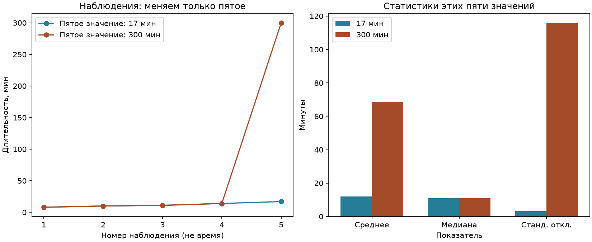
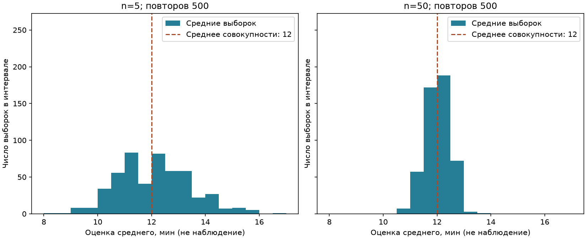

# Практическая статистика: что именно описывают числа

[Вход в урок](README.md) · [Исходный пример](example.py) ·
[NumPy](../01_numpy/theory.md) · [Качество данных](../03_data_quality/theory.md)

Вы уже умеете читать одномерный массив NumPy и проверять числовые значения.
Теперь задача — выбрать число, которое отвечает *конкретному* вопросу о данных,
и сказать, чего по нему узнать нельзя. Все наборы ниже маленькие,
синтетические и не требуют будущих уроков по ML. Сначала прогнозируйте ответ,
затем сверяйте ручной расчёт и код.

## 1. Что считается наблюдением?

В службе поддержки записали время ответа на пять **разных заявок**: `8, 10,
11, 14, 17` минут. Вопрос: «Пятая запись — ещё одна заявка или ещё один
замер первой заявки?» От ответа зависит, можно ли считать пять строк пятью
самостоятельными наблюдениями.

**Наблюдение (observation)** — единица, о которой записана строка; здесь заявка.
**Признак (feature, variable)** — измеряемое свойство этой единицы; здесь
время ответа в минутах. **Выборка (sample)** — пять наблюдений, попавших в
наш набор. **Генеральная совокупность (population)** — все заявки в чётко
названных границах, например за один месяц работы службы, о которых мы хотим
делать вывод. Массив из пяти значений сам по себе не доказывает, что он
представляет такой месяц: способ отбора и пропущенные заявки имеют значение.

**Распределение (distribution)** говорит, какие значения встречаются и как
часто. Для этой маленькой выборки каждое из пяти значений встретилось один
раз. Если из неё равновероятно выбрать одну запись, доля значения `14` равна
`1/5`; это описание имеющихся строк, а не автоматически вероятность для
любой будущей заявки. Записывайте единицу строки, единицу измерения, период,
отбор и правила обработки пропусков до вычисления сводки.

Самостоятельно: если один клиент создал четыре заявки, какие два разных
вопроса возникают при подсчёте «числа клиентов» и «числа заявок»? Почему
нельзя незаметно сменить единицу посередине расчёта?

## 2. Почему одно необычное значение меняет историю?

Прогноз: если заменить только `17` минут на `300`, какое число сильнее
сдвинется — среднее или медиана? Это ровно массив из [`example.py`](example.py).
Исходный пример возвращает `11.0`: третье значение упорядоченного списка.

**Среднее арифметическое (mean)** распределяет сумму поровну между всеми
`n` наблюдениями: `x̄ = (x₁ + ... + xₙ)/n`. Здесь `xᵢ` — время `i`-й заявки
в минутах, `n = 5` — число заявок, `x̄` тоже измеряется в минутах.
Для обычной пятёрки сумма `8 + 10 + 11 + 14 + 17 = 60`, среднее `60/5 = 12`
минут. После замены сумма `343`, среднее `343/5 = 68.6` минуты.
**Медиана (median)** — центральное значение отсортированного набора; при
чётном количестве это среднее двух центральных. В обеих пятёрках медиана
`11` минут. Поэтому, если вопрос — «что было типично для этой пачки?»,
медиана не позволяет одной длинной задержке перетянуть ответ. Если вопрос —
«сколько всего минут ожидания накопилось?», сама эта задержка существенна:
не выбрасывайте её из суммы лишь потому, что она необычна.

```pycon
>>> import numpy as np
>>> base = np.array([8.0, 10.0, 11.0, 14.0, 17.0])
>>> slow = np.array([8.0, 10.0, 11.0, 14.0, 300.0])
>>> float(np.mean(base)), float(np.median(base))
(12.0, 11.0)
>>> float(np.mean(slow)), float(np.median(slow))
(68.6, 11.0)
```

Слово **выброс (outlier)** означает необычное для выбранного контекста
значение, а не доказанную ошибку. `300` минут может быть реальной задержкой;
сверьте журнал и правила измерения. **Асимметрия (skew)** здесь видна по
длинному правому хвосту: малые значения сгруппированы, одно большое далеко
справа. Среднее выше медианы в этой пачке, но один этот факт не доказывает
форму распределения всей службы.

Самостоятельно замените только `300` на `30`. Сначала предскажите направление
изменения среднего и медианы, затем проверьте. Назовите вопрос, для которого
`30` нельзя игнорировать.

## 3. Что говорит 95-й процентиль?

Вопрос: означает ли «95-й процентиль = 16.4 минуты» то, что в этой пятёрке
была заявка с временем `16.4`? Нет. **Квантиль (quantile)** задаёт границу
доли распределения; **процентиль (percentile)** обозначает её в процентах.
При конечной выборке правила вычисления квантиля различаются. Здесь и в
задании профиля используем метод NumPy `method="linear"` — его умолчание.

Для отсортированных `x₀ ≤ ... ≤ xₙ₋₁` NumPy располагает долю `q` между
индексами по позиции `h = (n − 1)q` и линейно интерполирует соседние значения.
`q` — доля от 0 до 1, `h` — безразмерный индекс, результат имеет единицы
признака. Для 95-го процентиля `q = 0.95`, `n = 5`, значит `h = 3.8`.
Между `x₃ = 14` и `x₄ = 17` получаем `14 + 0.8 × (17 − 14) = 16.4` минуты.
На 25% позиция `h = 1`, значит результат `10` минут. Интерполяция объясняет,
почему значение квантиля может отсутствовать среди наблюдений. Она не обещает,
что ровно 95% пяти строк лежит ниже `16.4`.

```pycon
>>> import numpy as np
>>> times = np.array([8.0, 10.0, 11.0, 14.0, 17.0])
>>> float(np.percentile(times, 25, method="linear"))
10.0
>>> float(np.percentile(times, 95, method="linear"))
16.4
```

Типичная ошибка — сравнивать отчёты с разными правилами квантилей как будто
различие вызвано данными. В отчёте укажите метод, размер выборки и единицы.
Особенно осторожно читайте высокий процентиль на пяти строках: он сильно
зависит от крайнего значения. Самостоятельно вычислите новый 95-й
процентиль после замены `17` на `30`, сначала по позиции `h`, затем NumPy.

## 4. Насколько разбросаны сами времена?

Прогноз: если все пять времён увеличить ровно на 2 минуты, изменится ли
разброс? Среднее вырастет на 2, но расстояния до своего среднего останутся
`−4, −2, −1, 2, 5` минут для исходной пятёрки.

**Дисперсия (variance)** — средний квадрат таких отклонений. Для
*всего переданного массива* `v₀ = Σ(xᵢ − x̄)²/n`. Здесь `Σ` означает сумму
по `i = 1, ..., n`; `v₀` имеет единицы `минуты²`. Ручной расчёт:
`(16 + 4 + 1 + 4 + 25)/5 = 50/5 = 10 минут²`.
**Стандартное отклонение (standard deviation)** — корень из дисперсии,
`s₀ = √v₀ = √10 ≈ 3.1623` минуты; его легче сопоставить с исходной шкалой.
Это разброс отдельных наблюдений, а не точность оценки среднего.

Есть две конвенции знаменателя. NumPy по умолчанию использует `ddof=0`, то
есть делит на `n`; именно это требует `data-statistical-profile`. Когда
случайная выборка служит оценкой дисперсии **большей** совокупности и
наблюдения независимы с одинаковым распределением и конечной дисперсией,
часто берут `ddof=1`: `v₁ = Σ(xᵢ − x̄)²/(n−1) = 50/4 = 12.5 минут²`.
Поправка делает оценку дисперсии совокупности несмещённой при этих условиях;
она не исправляет смещённый отбор, зависимость строк или ошибочные значения.
При `n = 1` знаменатель `n−1` равен нулю. Корень из `v₁` — выборочное
стандартное отклонение; сам корень не обещает несмещённой оценки
стандартного отклонения совокупности.

```pycon
>>> import numpy as np
>>> times = np.array([8.0, 10.0, 11.0, 14.0, 17.0])
>>> float(np.var(times, ddof=0)), float(np.var(times, ddof=1))
(10.0, 12.5)
>>> round(float(np.std(times, ddof=0)), 4)
3.1623
```

Типичная ошибка — назвать `ddof=0` «неправильным», а `ddof=1` «всегда
правильным». Сначала сформулируйте, описываете ли эти пять чисел или
оцениваете вариацию вне них. Вторая ошибка — принять `NaN` и бесконечность
за обычные измерения: политика их обработки должна быть частью контракта.
Самостоятельно прибавьте 2 к каждому времени и проверьте прогноз о двух
дисперсиях и среднем.

## 5. Почему условная вероятность меняет знаменатель?

В библиотеке за фиксированный период записали 100 посещений. Каждая строка —
одно посещение; два признака: есть ли членство (`M`) и взята ли книга (`B`).
Прогноз: равны ли «доля взявших книгу среди участников» и «доля участников
среди взявших книгу»?

| Посещение | Книгу взяли `B` | Не взяли `¬B` | Итого |
| --- | ---: | ---: | ---: |
| Участник `M` | 30 | 10 | 40 |
| Не участник `¬M` | 12 | 48 | 60 |
| Итого | 42 | 58 | 100 |

**Событие (event)** — условие на исход, например «взяли книгу».
Эмпирическая доля `P(B) = 42/100 = 0.42`. Это частота в таблице, а не
обещание о следующем посещении без допущения о сходных условиях и отборе.
**Условная вероятность (conditional probability)** ограничивает знаменатель
событием после вертикальной черты: `P(B|M) = P(B∩M)/P(M) = 30/40 = 0.75`.
Символ `∩` означает одновременное выполнение. В обратном вопросе
`P(M|B) = P(M∩B)/P(B) = 30/42 ≈ 0.7143`. Числитель 30 один и тот же;
знаменатели 40 и 42 разные. `P(A|C)` определена только при `P(C) > 0`.
Все вероятности безразмерны и лежат от 0 до 1.

```pycon
>>> member_and_borrow, member_only, borrow_only, neither = 30, 10, 12, 48
>>> member = member_and_borrow + member_only
>>> borrow = member_and_borrow + borrow_only
>>> member_and_borrow / member, member_and_borrow / borrow
(0.75, 0.7142857142857143)
```

**Независимость (independence)** двух событий означает, что знание одного
не меняет вероятность другого: `P(B|M) = P(B)`, когда `P(M)>0`, или
равносильно `P(B∩M)=P(B)P(M)`. В таблице `0.75 ≠ 0.42`, так что доли
зависимы. Для сравнения: если *предположить* два независимых честных
подбрасывания монеты, четыре пары `ОО, ОР, РО, РР` равновероятны,
`P(орёл на втором | орёл на первом) = 1/2 = P(орёл на втором)`.
Равные частоты небольшой выборки сами по себе не доказывают независимость
механизма.

Самостоятельно: из тех же 100 строк найдите долю `P(B|¬M)`. Объясните,
почему её знаменатель — 60, а не 100 и не 58.

## 6. Откуда берётся формула Байеса?

Часто известны доли вида «какова вероятность события при группе», а вопрос
задают наоборот. В таблице известно `P(B|M)=30/40`, но нужен `P(M|B)`.
Счёт даёт ответ прежде символов: среди 42 взявших книгу 30 участников.

Из `P(M∩B)=P(B|M)P(M)` и определения условной вероятности получается
**формула Байеса (Bayes' rule)**:

`P(M|B) = P(B|M)P(M) / P(B)`.

Здесь `P(M)=40/100`, а знаменатель складывает два непересекающихся пути к
событию `B`:

`P(B) = P(B|M)P(M) + P(B|¬M)P(¬M)`
`= (30/40)(40/100) + (12/60)(60/100) = 30/100 + 12/100 = 42/100`.

Подстановка возвращает `(30/100)/(42/100)=30/42`. Все величины — доли
посещений без единиц. Убедитесь, что группы `M` и `¬M` исчерпывают
совокупность и не пересекаются; при нулевом `P(B)` обратное условие
не определено. Термины **prior/base rate** (исходная доля `P(M)`),
**likelihood** (`P(B|M)`) и **posterior** (`P(M|B)`) называют роли чисел,
но не заменяют вопроса о знаменателе. При редком исходном событии даже
высокая чувствительность сигнала может соседствовать со многими ложными
сигналами: считайте обе ветви, прежде чем трактовать сигнал.

Типичная ошибка — подставить `P(B|M)` вместо `P(M|B)` или забыть путь
`¬M → B` в знаменателе. Самостоятельно поменяйте в таблице только число
`12` на `6` и пересчитайте две ветви, знаменатель и обратную долю.

## 7. Вместе ли меняются два числовых признака?

На трёх согласованных наблюдениях датчиков записаны `x = [1, 2, 3]` метра
и `y = [2, 4, 3]` секунды. Каждая пара относится к одному и тому же объекту.
Прогноз: если вторая координата у последней пары меньше, чем у средней,
обязана ли связь быть нулевой или отрицательной?

Средние `x̄=2 м`, `ȳ=3 с`. Отклонения `x` равны `[-1, 0, 1] м`, отклонения
`y` равны `[-1, 1, 0] с`; попарные произведения `[1, 0, 0] м·с`, сумма
`1 м·с`. **Выборочная ковариация (sample covariance)** при `n=3`:

`cov₁(x,y) = Σ(xᵢ−x̄)(yᵢ−ȳ)/(n−1) = 1/2 = 0.5 м·с`.

Положительный знак показывает совместное направление отклонений в этих
трёх парах. Величина зависит от шкал и единиц, поэтому сама по себе плохо
сравнивается между разными признаками. **Корреляция Пирсона (Pearson r)**
делит сумму попарных произведений на корень произведения двух сумм квадратов:

`r = Σ(xᵢ−x̄)(yᵢ−ȳ) / √[Σ(xᵢ−x̄)² · Σ(yᵢ−ȳ)²]`.

Здесь обе суммы квадратов равны 2, поэтому `r=1/√(2·2)=0.5` без единиц.
При ненулевом разбросе каждой оси `r` лежит в `[-1,1]`. Для одной пары
выборочная ковариация не определена; если любая ось постоянна, знаменатель
корреляции нулевой и `r` не определён. Пары нельзя фильтровать по осям
отдельно: это создаёт сочетания, которых не измеряли.

```pycon
>>> import numpy as np
>>> x = np.array([1.0, 2.0, 3.0])
>>> y = np.array([2.0, 4.0, 3.0])
>>> float(np.cov(x, y, ddof=1)[0, 1]), float(np.corrcoef(x, y)[0, 1])
(0.5, 0.5)
```

Корреляция говорит о **линейной** связи, не устанавливает причину,
направление действия или отсутствие иных факторов. Нулевой `r` не означает
независимости: для `x=[−1,0,1]`, `y=[1,0,1]` связь `y=x²` полностью
определена, но положительное и отрицательное линейные произведения
сокращаются. Необычные пары тоже могут сильно менять `r`.

Самостоятельно замените только последнюю `y` с `3` на `5`. Сначала
предскажите знак ковариации и направление изменения `r`, затем вычислите.
Почему даже большое положительное `r` не говорит, какой датчик вызвал
изменение другого?

## 8. Проверка, перенос и источники

### Почему среднее меняется при новом отборе?

Вопрос: если служба не изменилась, обязаны ли две новые выборки дать одно
среднее? Нет: в них могут попасть разные заявки. Это
**изменчивость оценки (sampling variability)**, а не обязательно изменение службы.
Исходная пятёрка `[8,10,11,14,17]` может служить искусственной конечной
совокупностью: каждый из пяти возможных исходов имеет шанс `1/5`. Если
независимо выбирать с возвращением `n` раз и усреднять, среднее выборки
меняется от повтора к повтору. «С возвращением» означает, что выбранное значение
остаётся доступным для следующего выбора. IID (independent and identically
distributed) означает независимые выборы с одним и тем же распределением.

Сначала два возможных маленьких повтора при `n=3`, без генератора:

| Повтор | Выбранные времена, мин | Сумма, мин | Оценка среднего, мин |
| --- | --- | ---: | ---: |
| A | `8, 10, 17` | `35` | `35/3 ≈ 11.6667` |
| B | `14, 14, 17` | `45` | `45/3 = 15` |

Повторное `14` допустимо: выбор с возвращением. Среднее всей искусственной
совокупности осталось `12`, хотя оценки различаются. Эта таблица — иллюстрация
двух возможных выборок, не первые строки случайного запуска ниже.

```pycon
>>> import numpy as np
>>> a = np.array([8.0, 10.0, 17.0])
>>> b = np.array([14.0, 14.0, 17.0])
>>> round(float(a.mean()), 4), float(b.mean())
(11.6667, 15.0)
```

Разброс *одного* выбранного времени имеет
дисперсию `10 минут²`, а разброс *выборочного среднего* при именно этих
независимых одинаково распределённых выборах — `10/n минут²` и стандартное
отклонение `√10/√n` минут. Это следует из сложения дисперсий независимых
выборов и деления суммы на `n`; это не обещание конкретного результата одного
запуска. При зависимых заявках, изменении режима работы службы или отборе
без возвращения формула требует пересмотра.

Здесь `n` — число выборов **внутри одного повтора**, не число повторов опыта.
При `n=5` теоретическое стандартное отклонение среднего равно
`√(10/5) = √2 ≈ 1.4142 мин`; при `n=50` — `√(10/50) ≈ 0.4472 мин`.
Усредняем `n` независимых величин: дисперсия суммы `n×10`, деление самой суммы
на `n` делит её дисперсию на `n²`, поэтому `(n×10)/n² = 10/n`.
Это дополнительное объяснение формулы; сейчас важнее не путать два разброса.

**Перед запуском:** станет ли шире или уже распределение 500 средних при
переходе от `n=5` к `n=50`? Обязано ли среднее каждого повтора точно равняться
`12`? Запишите прогноз до вычислений.

В teacher-демонстрации `stats_demo.py` два рисунка, каждый из двух панелей:
первый показывает исходную пятёрку и замену `17 → 300`; второй — 500 повторов
средних при `n=5` и `n=50` с фиксированным seed 2026. Из корня репозитория:

```powershell
uv run --offline --no-sync python -m modules.03_data_foundations.04_practical_statistics.stats_demo
```

Для сохранения в *новый* каталог используйте
`--output reports/stats-demo-01`; это создаёт графики и таблицу частот.
Если ещё нет локального окружения с визуализацией, подготовьте его через
`uv sync --locked --group visualization`. Экспорт также сохраняет исходные
выборы `draws_n5.csv`, `draws_n50.csv`, оценки `sample_means.csv`, исходную
пятёрку и её статистики, параметры/версии в `metadata.json`. Это позволяет
пересчитать каждую оценку, а не полагаться только на seed.



На первом рисунке слева горизонтальная ось — номер заявки, вертикальная —
минуты. Линии только соединяют номера для чтения, не описывают течение времени.
Справа — среднее, медиана и стандартное отклонение `ddof=0`, все в минутах.
Дисперсия в минутах² не смешана с ними на одной оси.



На втором рисунке горизонтальная ось — среднее пяти или пятидесяти выборов
в минутах, вертикальная — число повторов в интервале.
Сравните ширину распределений средних; визуальная близость к формуле зависит
от случайных 500 повторов. Таблица членства и взятия книги выше даёт
разобранный Байес без третьего графика.

При seed 2026 и версиях из [журнала](../../../docs/theory-packet-3-verification.md)
программа дала средние 500 оценок `12.07000` и `12.00784`, а их эмпирические
стандартные отклонения `1.352375` и `0.452957` минуты (`ddof=1` в последней
печатной таблице). Не путайте их с исходным `√10 ≈ 3.1623` минуты (`ddof=0`)
и с теоретическими `1.4142`/`0.4472`: 500 повторов тоже конечная выборка.

**После запуска:** объясните различие ширины панелей и единицу одного элемента
гистограммы. Чего эти рисунки не доказывают о реальных заявках?
**Типичная ошибка:** «500 повторов делают зависимые заявки независимыми» или
«любой набор обязан иметь нормальное распределение». Опыт предполагает IID,
а не проверяет это предположение; форма реальных данных может быть иной.
**Самостоятельная вариация:** до повторного запуска с `--seed 7` укажите,
что обязано остаться прежним, а что может измениться. Не подбирайте seed под
желаемый результат; при экспорте выберите другую новую папку. Ручная проверка:
пересчитайте одно среднее из строки `draws_n5.csv` и найдите его по номеру
`repetition` в `sample_means.csv` (нумерация с нуля).

### Самостоятельная проверка понимания

Ответьте своими словами и обоснуйте ответ конкретными числами или контрпримером:

1. Что изменится в смысле выборки, если две строки относятся к одному клиенту?
2. Почему `300` сильно двигает среднее, но не медиану этой пятёрки?
3. Почему интерполированный 95-й процентиль может не быть наблюдением?
4. В каком вопросе нужен `ddof=0`, а в каком можно обосновать `ddof=1`?
5. Чем различаются `P(B|M)` и `P(M|B)` по знаменателю?
6. Почему `r=0` не позволяет заключить независимость?
7. Почему стандартное отклонение отдельных времён и средних повторных
   выборок отвечают на разные вопросы?

Отдельно разберите неверное утверждение: «среднее почти 12, значит выборка
представительна и все заявки независимы». Какие дополнительные сведения
понадобятся? Тесты проверяют вычисления демонстрации и ваш код в упражнениях;
обоснованность этого объяснения требует ручной проверки, не автозачёта.

Перенос в практику: [профиль суммы](exercises/statistical_profile/README.md)
(`data-statistical-profile`) требует собственного решения для пропусков,
бесконечностей и описания разброса; [вероятность после сигнала](exercises/bayes_alert/README.md)
(`data-bayes-alert`) применяет другой предметный контекст и свои входные
ставки; [парные наблюдения](../exercises/paired_observations/README.md)
(`data-paired-observations`) требуют сохранить пары при фильтрации. Здесь
нет готовых ответов для их `starter.py`. Только после уроков
[validation](../../04_machine_learning/02_validation/README.md) и
[evaluation](../../04_machine_learning/05_evaluation/README.md) имеет смысл
перейти к [парному сравнению моделей и cluster bootstrap](../exercises/paired_model_comparison/README.md)
(также нужны `data-paired-observations`),
затем к [рандомизированному эксперименту](../exercises/randomized_experiment/README.md).
Последнему также нужен `data-statistical-profile`.
Нынешний урок не вводит полный курс проверки гипотез или bootstrap.

Источники проверены по официальным страницам 2026-10-04, английский язык:

1. Diez, Barr, Çetinkaya-Rundel, *OpenIntro Statistics*, 4-е изд.,
   [страница книги](https://www.openintro.org/book/os/): §1.2 Data basics и
   §1.3 Data collection principles (единица и отбор), §2.1 Examining numerical
   data (сводки), §3.1 Defining probability и §3.2 Conditional probability
   (условие и независимость; на странице доступны и слайды). Остановитесь до главы 5
   об inferential procedures. Страница подтверждает разделы; PDF по ссылке
   на доступную версию во время проверки не открылся, поэтому ссылки на
   страницы PDF и дословные цитаты здесь не приводятся.
2. NumPy Developers, [Statistics API](https://numpy.org/doc/stable/reference/routines.statistics.html):
   откройте в этом указателе `percentile`
   для `method="linear"` и `var`
   для `ddof`. Остановитесь после описания этих параметров и базовых примеров;
   документация API не решает, какая совокупность и единица строки у ваших данных.
