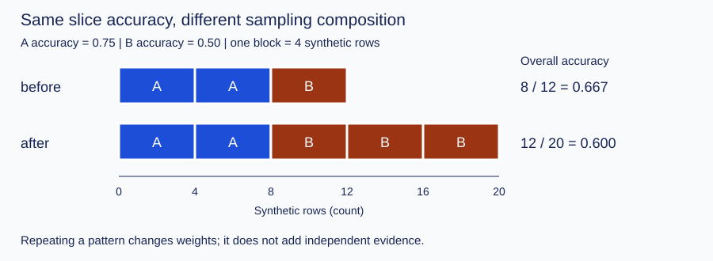

# Bias and fairness: что именно сравнивают группы

После [метрик, порога и calibration](theory.md) задача этого дополнения —
различить сбой сбора данных, ошибку модели и выбранное правило сравнения.
Нужны только binary confusion matrix и доли. Результат: объяснить, почему
один средний score и даже равные групповые rates не дают универсального
«fairness PASS». Здесь группы — **типы технических датчиков**, все строки
синтетические; социальные критерии изучаем как математические определения,
не как инструкцию принимать реальные решения о людях.

## Сначала прогноз

Датчики A/B предупреждают о перегреве стенда. `actual=1` — перегрев по
эталонной проверке; `decision=1` — предупреждение уже зафиксированного правила.
У A 8 записей и 6 верных решений, у B — 4 записи и 2 верных.
**Прогноз 1:** если B встречается втрое чаще, а качество каждого типа то же,
изменится ли общая accuracy? Не называйте это ухудшением самой модели до расчёта.

Полезная интуиция: общий score — смесь. Сначала выясните, **кто попал в смесь**,
затем **что измерили**, затем **с чем сравнили**, и только потом — где ошиблось
правило. Эта цепочка описывает места проверки; стрелки не доказывают причинность.

| Место проверки | Термин (English) | Технический пример | Какие записи нужны |
| --- | --- | --- | --- |
| Попадание в аудит | selection / representation bias | Лог пишется чаще для A; потерянные пакеты B не видны | Инвентарь устройств, счётчики пропусков, правило включения |
| Измеренный признак | measurement bias | У B иная погрешность температуры, но код считает шкалы одинаковыми | Сверка с эталоном и протокол калибровки измерителя |
| Целевая метка | label bias | «Перегрев» размечали разными правилами или проверяли только предупреждения | Инструкция разметки, слепая повторная проверка всех режимов |

Здесь label bias выделен как ошибка измерения **целевого** понятия, measurement
bias — признака. Это удобное различение для расследования, не взаимоисключающая
универсальная классификация. Из counts нельзя определить, какая история произошла.
Общий взгляд на источники ошибок по жизненному циклу: Suresh & Guttag,
[§3.2–3.3](https://arxiv.org/html/1901.10002v4#S3.SS2).

Удаление названия группы из признаков не гарантирует равных ошибок: остаются
прокси-признаки, состав данных и качество эталона. Группу можно хранить для
разрешённого аудита, даже если предсказатель её не использует. «Сбалансировать
число строк» тоже недостаточно: неверный эталон от копирования не исправляется.

## Определения и знаменатели

Обозначим группу `g`, эталон `Y`, решение `D`. Все counts — число строк,
все rates безразмерны в `[0,1]`. Для каждой группы нужны не только `n` (*support*),
но и поддержки фактических положительных `P=TP+FN`, отрицательных `N=FP+TN`
и выданных предупреждений `Q=TP+FP`.

| Что спрашиваем | Доля | Знаменатель |
| --- | --- | --- |
| Как часто выдаётся предупреждение? selection rate | `Q/n` | Все строки группы |
| Какую часть перегревов нашли? TPR / recall / sensitivity | `TP/P` | Только реальные перегревы |
| Какую часть нормальных случаев зря предупредили? FPR | `FP/N` | Только нормальные случаи |
| Какая часть предупреждений подтверждена? PPV / precision | `TP/Q` | Только предупреждения |
| Как часто метка верна? accuracy | `(TP+TN)/n` | Все строки группы |

Для A: `TP=3, FP=1, FN=1, TN=3`; значит `P=3+1=4`, `N=1+3=4`,
`Q=3+1=4`, `n=8`. Подстановка: `TPR=3/4=.75`, `FPR=1/4=.25`,
`precision=3/4=.75`, `selection rate=4/8=.5`, `accuracy=(3+3)/8=.75`.
В коде каждое имя берётся из этих же cells; округляется только печать.

**Прогноз 2:** у группы одна строка `Y=0,D=0`. TPR равен нулю или неизвестен?
Ответ: знаменатель `P=0`, поэтому в данном audit-контракте TPR=`None`.
FPR=`0/1=0.0` определён. `None` — не пропуск для удаления из отчёта, а явное
«оценить по этим строкам нельзя». В существующих
[threshold policy](../exercises/threshold_policy/README.md) и
[evaluation report](../06_reproducibility/exercises/evaluation_report/README.md)
для учебного API выбрана конвенция `0.0`; здесь она намеренно иная.
Нельзя сравнивать форматы без проверки определений.

## Разобранный запуск: меняется sampling, не предсказатель

В [bias_slices.py](bias_slices.py) `a` — восемь triples `(group,Y,D)`,
`b` — четыре. Python `b * 3` повторяет этот tuple трижды.
`sampling_demo()` считает `a+b`, затем `a+b*3`; `summarize_rows` выбирает
группу, считает четыре cells, формирует знаменатели и возвращает все объявленные
группы, включая пустые. Для `all` меняется только техническая группировка строк.

```powershell
uv run python modules/04_machine_learning/05_evaluation/bias_slices.py
```

Полный ожидаемый вывод:

```text
sample group n TP FP FN TN TPR FPR accuracy
before A 8 3 1 1 3 0.750 0.250 0.750
before B 4 1 1 1 1 0.500 0.500 0.500
before all 12 4 2 2 4 0.667 0.333 0.667
after A 8 3 1 1 3 0.750 0.250 0.750
after B 12 3 3 3 3 0.500 0.500 0.500
after all 20 6 4 4 6 0.600 0.400 0.600
```

Ручная таблица до/после sampling совпадает с выводом:

| Выборка | n A / B | Верные A / B | Общая accuracy | A: TPR / FPR | B: TPR / FPR |
| --- | --- | --- | --- | --- | --- |
| before | 8 / 4 | 6 / 2 | `8/12=2/3` | `.75 / .25` | `.50 / .50` |
| after | 8 / 12 | 6 / 6 | `12/20=.60` | `.75 / .25` | `.50 / .50` |



На диаграмме один блок = 4 синтетические строки; длины 2+1 и 2+3 блока.
Общая accuracy — взвешенная: до `(8×.75+4×.5)/12=8/12`,
после `(8×.75+12×.5)/20=12/20`. Ошибка — усреднить `.75` и `.5`
без весов: `.625` описывает другую целевую смесь.
Повторение `b` — **искусственная смена состава**, не сбор независимых наблюдений,
не исправление bias и не основание сужать доверительный интервал.

Одна изменённая строка опыта: замените `(a+b, a+b*3)` на `(a+b, a*2+b)`.
**Прогноз 3:** сначала вычислите новые `n` и общую accuracy вручную, затем
запустите локальную копию. Не меняйте эталонную демонстрацию или тесты урока.
Демонстрация не обучает модель и не переопределяет замороженный порог.

## Почему критерии могут конфликтовать

Для binary решений разные критерии требуют равенства **разных условных долей**:

- Statistical / demographic parity: равные selection rates.
- Equal opportunity: равные TPR относительно выбранного положительного исхода.
- Equalized odds: одновременно равные TPR и FPR.
- Predictive parity: равные PPV при выбранном правиле принятия решения.

Первые три определения см. у Hardt, Price & Srebro,
[§2 и §3](https://arxiv.org/html/1610.02413v1#S2).
Они не взаимозаменяемы. У демонстрации selection rate равен `.5` в обоих
типах, а TPR/FPR различаются. Название положительного исхода тоже существенно:
здесь `1` означает перегрев, поэтому слово opportunity само по себе не выбирает
желаемую политику. Нужны цель проверки и цена пропуска/ложного предупреждения.

Пусть в другом синтетическом стенде доля перегревов `p=P/n` равна `.2` и `.8`.
Если обе группы имеют `TPR=t=.75` и `FPR=f=.25`, то

`PPV = (t×p) / (t×p + f×(1−p))`.

Для `p=.2`: истинные предупреждения на единицу выборки `.75×.2=.15`,
ложные `.25×.8=.20`, все `.35`, значит PPV=`.15/.35=3/7`.
Для `p=.8`: `.60/(.60+.05)=12/13`.
Таким образом, при разных `p` и **ненулевых** `t,f` equalized odds не даёт
predictive parity. При идеальных либо вырожденных предсказаниях возможны
исключения, а PPV иногда вообще не определён; фраза «всегда всё несовместимо»
неверна. Это связь долей, не причинное объяснение разрыва.
Источник: Chouldechova, [§2.1–2.3, equation 2.6](https://arxiv.org/html/1703.00056v1#S2.SS3).

Калибровка вероятности — ещё один вопрос: соответствует ли score `s` частоте
`Y=1` среди строк с этим score внутри группы? Она не равна PPV после порога:
после порога смешиваются разные scores. Для механики вернитесь к
[score / probability / calibration](theory.md#3-метки-score-вероятности-разные-вопросы).
Здесь нет нового алгоритма калибровки или «автоматического справедливого порога».

## Неопределённость и следующий шаг

Рядом с rates сохраняйте `n,P,N,Q`: при `P=2` один изменённый исход меняет TPR
на `.5`, при `P=200` — на `.005`. Даже одинаковые `n` не означают одинаковую
точность оценки FPR/TPR. Условие независимости тоже важно: тысяча соседних
сигналов одного устройства — не тысяча независимых устройств.
Для интервалов/повторных выборок используйте существующие
[статистику](../../03_data_foundations/04_practical_statistics/theory.md) и
[парное сравнение](../../03_data_foundations/exercises/paired_model_comparison/README.md):
единицей resampling может быть целое устройство. На этой игрушечной таблице
интервалы не оцениваются. Выбор многих срезов после просмотра повышает риск
случайной находки; exploratory разрыв надо проверить на новых допустимых данных.

До test фиксируют целевую популяцию, включение строк, определения меток/групп,
порог и критерии. После просмотра test можно описать ограничение и спланировать
новую проверку; переобучение/подбор требуют нового разделения данных.
Аудит количества ошибок не устанавливает причинность, намерение, юридическую
допустимость или безопасность применения. Человек оценивает контекст и последствия.

## Проверка понимания и практика

1. Почему одинаковый selection rate в демо совместим с разными TPR/FPR?
2. Какой знаменатель нужен для FPR, и почему число всех строк не подходит?
3. Почему `TPR=None` не лучше и не хуже `TPR=0.0`?
4. Как проверить гипотезу о measurement bias, не объявляя её доказанной counts?
5. Что меняется при смене A/B sampling, а что осталось фиксированным?
6. Какие условия нужны для приведённого конфликта PPV и equalized odds?
7. Что надо знать об устройствах и сборе данных до доверительного интервала?

<details><summary>Короткие ориентиры — после своей попытки</summary>

Selection rate использует все строки, TPR/FPR — разные подмножества.
FPR делит на нормальные случаи. `None` означает отсутствие знаменателя,
ноль — наблюдаемый числитель при ненулевом знаменателе. Для измерений нужна
эталонная сверка и сопоставимый протокол. Sampling меняет веса смеси;
внутри групп в демо клетки масштабируются пропорционально. Конфликт PPV
требует разных base rates, положительных общих TPR/FPR и определённых долей.
Для неопределённости нужны независимые единицы, покрытие и правило отбора.

</details>

Теперь реализуйте один новый контракт
[grouped sensor slices](../exercises/bias_slices/README.md) (`ml-bias-slices`),
затем выполните его самостоятельное исследование и REVIEW.
Для пороговой политики уже есть `ml-threshold-policy`, после воспроизводимости —
`ml-evaluation-report`; для полного исследования с calibration —
[tabular study](../exercises/tabular_study/README.md) (`ml-tabular-study`).
Эти задания сохраняют свои prerequisites и прежние контракты; данный урок
не содержит их решений и не заполняет выводы ученика.

## Источники и где остановиться

Проверено 2026-10-28 чтением первичного HTML в браузерном поиске; язык английский.
Материалы вводят определения, не предоставляют универсальный checklist допуска.

- Harini Suresh, John Guttag, *A Framework for Understanding Sources of Harm
  throughout the Machine Learning Life Cycle* (2021):
  [§3.2–3.3](https://arxiv.org/html/1901.10002v4#S3.SS2).
  Читать различие representation/measurement, остановиться перед §3.4.
- Moritz Hardt, Eric Price, Nathan Srebro, *Equality of Opportunity in Supervised
  Learning* (2016): [§2–3](https://arxiv.org/html/1610.02413v1#S2).
  Сверить conditional definitions; остановиться перед алгоритмами §4.
- Alexandra Chouldechova, *Fair Prediction with Disparate Impact* (2017):
  [§2.1–2.3](https://arxiv.org/html/1703.00056v1#S2.SS1).
  Отличить calibration от predictive parity и проверить equation 2.6;
  остановиться перед прикладным анализом §3. Социальный контекст статьи
  не переносится на наш синтетический стенд как доказательство.
