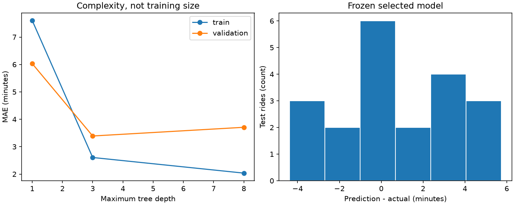
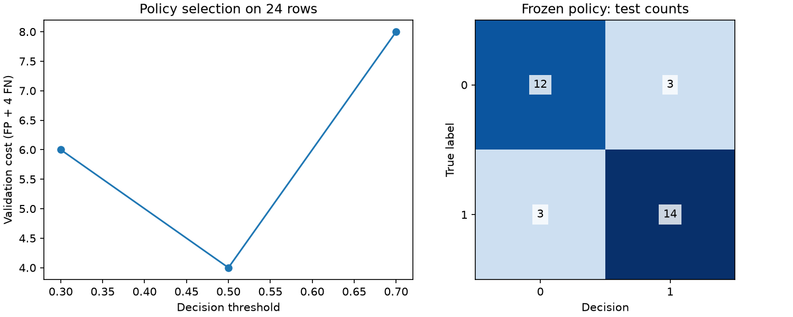

# Воспроизводимость: сохранить не только число

После [evaluation](../05_evaluation/theory.md) у вас есть итоговая метрика.
Следующий вопрос: сможет ли другой человек на тех же данных и в указанном
окружении проверить, откуда она взялась? Этот урок продолжает
[validation](../02_validation/README.md) и
[preprocessing](../03_preprocessing/README.md). Сначала попробуйте мысленно
воспроизвести модель, если вам дали только `accuracy=0.85` и `seed=31`.
Каких сведений не хватает? Ниже — минимальная цепочка свидетельств, а не
обещание побитового совпадения на любых платформах.

## 1. Что именно следует воспроизвести

Результат зависит от определения цели и момента предсказания, исходных bytes
данных, ID строк и их разбиения, кода обработки признаков, обученной модели,
конфигурации выбора, версий библиотек и самих предсказаний. Seed управляет
частью случайности, но не фиксирует порядок входных строк, численные библиотеки,
платформу или будущую версию scikit-learn.

**Prediction contract:** для каждого нового объекта сохраняйте названия и порядок
исходных признаков, типы, единицы, допустимые пропуски и смысл целевой метки.
Если при обучении числовые пропуски заменялись медианой, а категория кодировалась
словарём, на inference нужны **те же fitted преобразования**. Храните их вместе с
моделью в `Pipeline`/`ColumnTransformer`, а schema и параметры — в читаемой
конфигурации. Одна модель без preprocessing может принять массив правильной формы,
но иного смысла. Пример: температура в °C на train и °F на inference не вызывает
ошибку формы, зато разрушает смысл прогноза.

**До запуска:** если в сохранённом отчёте совпадают seed и метрика, достаточно
ли этого, чтобы доказать, что использовались те же train строки? Нет: нужен
snapshot разбиения или устойчивые ID и правило их формирования.

| Вопрос | Свидетельство | Чего оно само не доказывает |
| --- | --- | --- |
| Какие строки и значения были? | Неизменённый data snapshot, schema, SHA-256 его bytes | Что данные репрезентативны или получены честно |
| Кто участвовал в fit, selection, calibration и test? | Сохранённые ID по частям и правило split | Что скрытого предыдущего просмотра test не было |
| Что сравнивали и выбрали? | Исходные настройки кандидатов, metric, dev scores, frozen config | Что найденный вариант универсально лучший |
| Что реально выдала модель? | Predicted values/probabilities и ID test строк | Что отчёт не подгоняли вручную до сохранения |
| В какой среде это возможно повторить? | Версии Python/NumPy/sklearn, lockfile, код и его revision | Битовую идентичность на любой ОС/CPU |

## 2. Development сначала, test после заморозки

Зарезервируйте test до подбора. Для каждого кандидата fit модели и **обучаемого**
preprocessing происходит только на разрешённой train части. Из validation
или cross-validation выбирайте признаки, гиперпараметры и порог решения;
основную метрику и цену ошибок задайте **до** сравнения scores, иначе возникает
подбор удобной метрики под уже увиденный результат;
если требуется калибровка, её обучающие строки должны быть отдельно от строк,
по которым оценивается этот вариант. Порог настраивайте на development, а не
на test. Сохраните конфигурацию, затем один раз посчитайте test метрики.
Повторный inference для сверки сохранённого артефакта проверяет воспроизводимость
и не даёт права изменить конфигурацию по test.

**Ошибочная схема:** обучить imputer на всех строках, подобрать `alpha` и порог
по test и записать лучший test score как финальную проверку. Даже если численно
score не вырос, тестовая граница уже использована для выбора. **Корректная схема:**
разделить по единице будущего применения; каждый train fold самостоятельно
обучает imputer и модель, dev scores служат выбору, frozen pipeline и threshold
проходят один test. Подробности группового/временного split и fold preprocessing
даны в [validation](../02_validation/README.md) и
[preprocessing](../03_preprocessing/README.md).

Для парного сравнения с неопределённостью сохраните обе серии предсказаний на
одних и тех же объектах. [Парное упражнение](../../03_data_foundations/exercises/paired_model_comparison/README.md)
использует кластеры вместо отдельных зависимых строк; краткая теория изменчивости
есть в [статистике](../../03_data_foundations/04_practical_statistics/theory.md).
Ни seed, ни bootstrap не исправляют неверно выбранную единицу разбиения.

## 3. Маленькая арифметика: перепроверить сохранённый отчёт

Предположим, сохранены ID `A,B,C,D`, метки `[0,1,1,0]`, вероятности
`[0.1,0.8,0.4,0.7]` и **замороженный** порог `0.5`. Тогда решения
`[0,1,0,1]`; FP=1, FN=1, accuracy=`2/4=0.5`, Brier=
`(0.01+0.04+0.36+0.49)/4=0.225`. Эти числа можно пересчитать из
`predictions.csv`, если там есть ID, true labels, вероятности и решения.
Полный разбор метрик — [в предыдущем уроке](../05_evaluation/theory.md#2-классификация-четыре-клетки-до-одного-процента).

```pycon
>>> labels = [0, 1, 1, 0]
>>> probabilities = [0.1, 0.8, 0.4, 0.7]
>>> decisions = [int(p >= 0.5) for p in probabilities]
>>> decisions
[0, 1, 0, 1]
>>> round(sum((p - y) ** 2 for y, p in zip(labels, probabilities)) / len(labels), 3)
0.225
```

**Типичная ошибка:** сохранить только округлённый `accuracy=0.5`. По нему нельзя
восстановить, какие строки ошибочны, сравнить группы или заново рассчитать Brier.
**Вариация:** измените одно `0.7 → 0.6`; заранее скажите, какие из решения,
confusion matrix и Brier останутся теми же. Признаки, метки и порог не меняйте.

## 4. Сквозная преподавательская демонстрация

Новая локальная демонстрация использует **два независимых учебных синтетических
сценария**, не данные ученика: длительность 96 поездок и бинарное состояние
160 датчиков. Она показывает путь «постановка → split → baseline → preprocessing
→ fit → development choice → frozen test → ошибки → сохранение → reload». Её
числа демонстрируют механику на этих данных и не доказывают качество для
реальных поездок/датчиков. До запуска предскажите, обязательно ли самое гибкое
дерево выиграет validation MAE и обязательно ли калибровка улучшит Brier.

Из корня репозитория выберите **новую** выходную папку:

```powershell
uv run --offline --no-sync python -m modules.04_machine_learning.06_reproducibility.classical_demo --output reports/classical-demo-01
```

Существующую папку демонстрация не перезаписывает. `--plots` добавляет
необязательные графики в том же новом запуске при подготовленной группе
`visualization`; текстовые данные и расчёты доступны без Matplotlib. До
просмотра графиков задайте себе вопрос: какое изменение по оси X изображено?
Изменение метрики по сложности модели, по объёму train и по шагам обучения
— разные эксперименты. После графика проверьте его подписи по сохранённым
числам; от самого вида линии нельзя заключить причинность или универсальность.

**Поездки.** Каждая строка — независимая учебная поездка. Сначала выделяются
20 test строк (`20%`), затем из оставшихся 76 выделяются 19 validation строк
(`25%` от оставшихся), train содержит 57. Baseline предсказывает train mean.
Ridge с `alpha=0.1`/`10` и дерево с глубиной `1`/`3`/`8` обучаются только
на train; выбор идёт по validation MAE. Выбранная модель **не переобучается**
на train+validation перед test: это фиксированный протокол именно данной
демонстрации. Он упрощает воспроизведение, но оставляет меньше train данных.

**Датчики.** Test содержит 32 стратифицированные строки; внутри development
раздельно используются 80 train, 24 selection и 24 calibration строк.
`LogisticRegression` с `C=0.1`/`1` fit только на train. Сырой вариант
выбирается по Brier на selection. Sigmoid calibrator обучается только на
calibration для выбранной модели. Затем на selection сравниваются raw и
calibrated вероятности и пороги `0.3`, `0.5`, `0.7` при **учебной** цене
`FP=1`, `FN=4`. После фиксации выбора идёт test. Повторное использование
selection для этих решений может давать оптимистичную оценку внутри development;
это причина сохранять отдельный финальный test. Здесь нет CV: упражнение
[model comparison](../04_models/exercises/model_comparison/README.md)
показывает работу с фолдами отдельно.

Внутри каждого сценария новый каталог `cycling/` или `sensors/` содержит
`data.csv`, `predictions.csv`, `model.pkl` и `report.json`. Сверьте ID split
из отчёта с test строками; пересчитайте метрику из сохранённых test labels и
predictions; сравните прогноз до/после reload. `report.json` описывает
выбранную конфигурацию, development след, версии, schema и hashes. Входные
данные и выводы преподавательские: они не являются вашим
[tabular study](../exercises/tabular_study/README.md), не заполняют его report
и не отмечают progress. Для собственного исследования нужны его отдельный
контракт и ручная защита.

При стандартном `seed=31` в проверенном локальном окружении Python 3.12.14,
NumPy 2.5.3, pandas 3.0.6, scikit-learn 1.9.1 получился следующий **учебный**
результат; в иной среде проверяйте собственный `report.json`, а не требуйте
совпадения всех последних знаков:

| Сценарий | Development выбор | Замороженный test |
| --- | --- | --- |
| Поездки | `ridge-0.1`, validation MAE `1.6778` мин против baseline `10.7434` мин | `n=20`, MAE `2.3689` мин против baseline `13.9005` мин |
| Датчики | `C=1`, sigmoid, порог `0.5`; selection Brier raw `0.07285`, calibrated `0.07010` | `n=32`, `[[TN=12, FP=3], [FN=3, TP=14]]`, Brier `0.09919`, baseline Brier `0.24938` |

Эти значения получены запуском CLI, а не обещаны любой случайной выборке.
Например, итоговая стоимость датчиков пересчитывается прямо из test матрицы:
`3·1 + 3·4 = 15` условных единиц; precision = `14/(14+3) ≈ 0.8235`.
В `cycling/predictions.csv` лежат `row_id`, `group`, `target`, `prediction`,
`baseline_prediction`; в `sensors/predictions.csv` — `row_id`, `group`,
`target`, `probability`, `decision`, `baseline_probability`. `report.json`
связывает их с `splits`, `features`, `schema`, `selection`, `development`,
`test_metrics`, `error_slices`, `versions`, `sha256` и флагом сверки reload.
У поездок `error_slices` делит test на paved (`n=7`, MAE `1.4765` мин) и
gravel (`n=13`, MAE `2.8494` мин). У датчиков low-vibration (`n=14`) имеет
`FP=0`, `FN=2`, high-vibration (`n=18`) — `FP=3`, `FN=1`. Сравните не только
значение метрики, но и знаменатель каждого среза. Эти группы заданы учебным
сценарием; маленький test не устанавливает устойчивого преимущества группы.

Перед рисунками предскажите, совпадёт ли порядок деревьев по train MAE и
validation MAE; изменится ли подпись confusion matrix, если вместо test
взять selection? Второй вопрос важен: рисунок справа показывает только
замороженный **test**, левый пороговый — **selection**.



На `complexity.png` левая ось X — `max_depth` (`1`, `3`, `8`), Y — MAE в минутах;
это зависимость от гиперпараметра, не от размера train. Правая ось X —
`prediction − actual` в минутах, Y — число test поездок в интервале.
Линии получены из учебного запуска и не утверждают, что дерево глубины 8
всегда хуже. После просмотра объясните, почему его train ошибка может
уменьшиться, а validation ошибка вырасти.



На `decisions.png` левая ось X — три заранее заданных порога, Y — стоимость
решений на 24 selection строках. Справа горизонтальная ось — решение, вертикальная
— истинная метка, числа в клетках относятся к 32 **test** строкам. После
просмотра объясните, почему эти 32 строки нельзя использовать для нового
выбора порога. Графики опциональны: предыдущая таблица и CSV позволяют
проверить вывод без Matplotlib.

Ранее существовавший [example.py](example.py) демонстрирует только checksum
буквального CSV и метаданные среды. Он **не** сохраняет и не загружает модель;
новая демонстрация показывает этот следующий шаг. Прогнозируйте перед запуском:
если поменять порядок колонок на inference, достаточно ли того же числа
признаков? После запуска объясните, как schema и сохранённый preprocessing
помогают обнаружить ошибку.

## 5. Доверие к артефакту — отдельная граница

`model.pkl` содержит Python-объект; pickle/joblib-десериализация способна
выполнить код. Загружать разрешено только объект известного происхождения в
документированной среде. Демонстрация создаёт артефакт и загружает **свой же
файл в том же вызове**, без произвольного пользовательского пути для загрузки.
Не используйте её как команду открытия чужого `model.pkl`.

SHA-256 обнаруживает изменение bytes относительно заранее известного digest.
Если неизвестный источник прислал и файл, и hash, совпадение не устанавливает
его подлинность и не делает pickle безопасным. Даже trusted artifact может
потерять совместимость между версиями Python/sklearn; сохраняйте lockfile,
версии и понятный путь повторного обучения. JSON-отчёт удобен для просмотра,
но совпадение чисел и hash само не доказывает происхождение датасета или
честность эксперимента.

## 6. Перенос и самопроверка

Сначала из `predictions.csv` демонстрации вручную пересчитайте одну test
метрику и найдите два характерных промаха. Затем объясните, почему наличие
`model.pkl` не достаточно без schema, preprocessing и конфигурации. После этого
выполните [evaluation report](exercises/evaluation_report/README.md)
(`ml-evaluation-report`) на его **собственных заданных** входах. Для полного
самостоятельного эксперимента следуют
[tabular study](../exercises/tabular_study/README.md) и открытый
[evaluation case](../exercises/evaluation_case/README.md). Теория не даёт
диагностического решения последнего.

1. Как вы отличите повторный inference для проверки от нового подбора по test?
2. Что сохраните, чтобы проверить отсутствие пересечения train и test ID?
3. Почему один seed не фиксирует результат между версиями библиотек?
4. Что нужно хранить вместе с fitted estimator для верного inference?
5. Почему соответствие SHA-256 не даёт разрешения загрузить чужой pickle?
6. Какие выборы в демонстрации датчиков делаются на selection, какие строки
   обучают calibrator, а какие остаются test?
7. Почему успешный запуск преподавательской демонстрации не засчитывает
   собственный tabular study?

После классического ML переходите к
[математическому мосту](../07_training_bridge/README.md), затем к
[PyTorch lab](../../../labs/01_pytorch_foundations/README.md). Мост объясняет
loss, градиент и собственный шаг; он не заменяет проверку качества модели.

Источники проверены по официальной документации scikit-learn 2026-10-04,
английский язык: [Model persistence](https://scikit-learn.org/stable/model_persistence.html)
(риски pickle, совместимость; остановитесь после выбора формата и требований
доверия), [Common pitfalls](https://scikit-learn.org/stable/common_pitfalls.html)
(leakage и контролируемая случайность),
[Probability calibration](https://scikit-learn.org/stable/modules/calibration.html)
(обучение калибровки на отдельных данных). Эти страницы не подтверждают
добросовестность конкретного локального запуска; её нужно проверять по
сохранённым данным, коду и процедуре.
