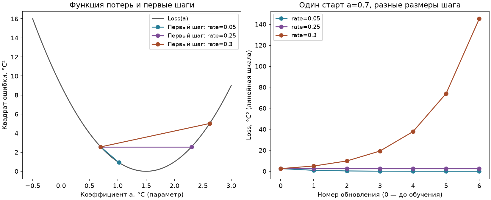

# От ошибки предсказания к направлению шага

[Вход в урок](README.md) · [Скалярный код](example.py) ·
[Трасса и необязательный график](descent_demo.py) · [Свой шаг](starter.py)

Предпосылки: [формы и операции NumPy](../../03_data_foundations/01_numpy/theory.md),
[постановка задачи](../01_problem_framing/README.md),
[validation и leakage](../02_validation/README.md),
[модели и baseline](../04_models/README.md), [метрики](../05_evaluation/README.md).
Этот седьмой урок стоит после ML-основ: он не нужен для прохождения EDA или
статистики. Цель — суметь вручную объяснить, почему один конкретный параметр
сдвигается в конкретную сторону. Сначала прочитайте §1–4 без запуска и запишите
прогноз; затем сравните с кодом. Весь случай синтетический.

## 1. Практический вопрос и интуиция

Датчик выдаёт калиброванный вход `2`, а эталон показывает `3 °C`. Как изменить
коэффициент, чтобы предсказание приблизилось к эталону? NumPy умеет вычислять
предсказание по уже заданному коэффициенту. **Обучение (training)** меняет
**параметр (parameter)** на основании ошибки. Это ещё не гарантия качества на
новом датчике: решение, полезное на train, проверяют на validation; финальный
test не используют для подбора параметров, числа шагов или learning rate.

Представьте график ошибки как чашу. Касательный наклон в текущей точке указывает,
в какую сторону ошибка растёт *поблизости*. Шаг против наклона может её уменьшить.
Касательная сообщает локальное направление, но сама не обещает успех для любого
размера шага и не сообщает ничего о качестве на новых данных.

**Прогноз до вычислений:** если коэффициент `a = 0.7`, предсказание `2a` меньше
эталона `3`. Нужно увеличить или уменьшить `a`? Какой знак должен иметь наклон
квадрата ошибки?

## 2. Один параметр: прогноз → ошибка → квадрат

В старом [example.py](example.py) аргумент назван `offset` ради прежнего
программного интерфейса. Математически это **множитель входа** `2`, то есть
коэффициент `a`, а не прибавляемое смещение (bias/intercept). Интерпретируем `2`
как безразмерный калиброванный вход; `a` имеет единицу `°C`, и `2a` — прогноз в
`°C`. Это выбор единиц для маленького примера, а не физическая модель термометра.

Определим предсказание (prediction) `p(a) = xa`, остаток/ошибку (residual/error)
`e(a) = p(a) − y` и функцию потерь (loss) `L(a) = e(a)² = (2a − 3)²`. Здесь
`x = 2` — фиксированный безразмерный вход (скаляр), `y = 3 °C` — фиксированное
целевое значение (скаляр), `a` — изменяемый скалярный параметр в `°C`, `p` и `e`
— скаляры в `°C`, а `L` — скаляр в `°C²`. При одном наблюдении это квадрат ошибки;
при нескольких наблюдениях среднее таких квадратов называют MSE. Здесь нет
добавленного bias и нет обучения общей регрессионной модели.

Ручная подстановка при `a₀ = 0.7 °C`:

1. `p₀ = 2 × 0.7 = 1.4 °C`.
2. `e₀ = 1.4 − 3 = −1.6 °C`.
3. `L₀ = (−1.6)² = 2.56 °C²`.

Индекс `0` означает состояние *до* обновления, а не номер наблюдения. Квадрат
делает положительный и отрицательный остатки одинакового модуля равными по loss;
он сильнее штрафует большие остатки. **Типичная ошибка:** принять `−1.6` за
градиент. Это ошибка предсказания в `°C`; градиент должен показывать изменение
`L` при изменении `a`.

## 3. Производная и chain rule: три локальных звена

**Производная (derivative)** `dL/da` — предел отношения изменения `L` к малому
изменению `a`. В нашей точке локальное приближение записывается
`L(a₀ + h) ≈ L(a₀) + (dL/da)|ₐ₀ h`, где `h` — малое изменение коэффициента в
`°C`, `L` и его изменение — в `°C²`, а `dL/da` — в `°C²/°C = °C`.
Например, для `h = 0.01 °C` приближение ниже даёт `2.496 °C²`, а точный квадрат
даёт `2.4964 °C²`. Разница напоминает: касательная хороша лишь поблизости;
вдали от точки её линейный прогноз расходится с искривлённой функцией.

**Правило цепочки (chain rule)** идёт по реальному порядку вычислений:
`a → p = 2a → e = p − 3 → L = e²`. Локальные производные:

| Звено | Производная | Единицы |
| --- | --- | --- |
| предсказание по параметру | `dp/da = x = 2` | безразмерная |
| остаток по предсказанию | `de/dp = 1` | безразмерная |
| квадрат по остатку | `dL/de = 2e` | `°C` |

Следовательно, `g(a) = dL/da = (dL/de)(de/dp)(dp/da) = 2e × 1 × 2 =
4(2a − 3)`. `g` — скалярный градиент в `°C` (единица loss на единицу
параметра), а не новый параметр. В точке `a₀ = 0.7 °C` получаем
`g₀ = 2 × (−1.6) × 1 × 2 = −6.4 °C`. Поэтому малая прибавка к `a`
уменьшает loss: локальное изменение примерно `−6.4 × h` в `°C²`.

**Шаг градиентного спуска (gradient descent)** в этом соглашении:
`a₁ = a₀ − ηg₀`. Здесь `η = 0.05` — заданный безразмерный learning rate,
`a₀` и `a₁` — коэффициенты в `°C`, `g₀` — производная в `°C`; произведение
`ηg₀` снова имеет единицу `°C`. Считаем без пропусков:

1. `ηg₀ = 0.05 × (−6.4) = −0.32 °C`.
2. `a₁ = 0.7 − (−0.32) = 1.02 °C`.
3. `p₁ = 2.04 °C`, `e₁ = −0.96 °C`, `L₁ = 0.9216 °C²`.

Это ровно формулы существующих `loss`, `gradient`, `step`: они вычисляют один
фиксированный скалярный случай. `a` — параметр, меняющийся при шаге; `η` —
**гиперпараметр (hyperparameter)**, который выбирают для процедуры *до*
финального test. Также гиперпараметром было бы число шагов. Минимум этой
конкретной чаши находится при `a = 1.5 °C`, где `p = 3 °C`, `L = 0` и `g = 0`.
Вообще нулевой градиент может встретиться и вне минимума.

Проверяем те же числа непосредственно через прежние функции. В Python запись
`import_module` нужна здесь только потому, что имя пакета начинается с цифр;
вывод округлён до четырёх знаков для чтения, сами функции не округляют:

```pycon
>>> from importlib import import_module
>>> example = import_module("modules.04_machine_learning.07_training_bridge.example")
>>> a = 0.7
>>> round(example.loss(a), 4), round(example.gradient(a), 4)
(2.56, -6.4)
>>> a1 = example.step(a, 0.05)
>>> round(a1, 4), round(example.loss(a1), 4)
(1.02, 0.9216)
```

**Прогноз:** что случится с `L` после одного шага из `0.7`, если взять `η =
0.25` или `0.3`? Проверьте вручную прежде, чем запускать трассу.

## 4. Размер шага и численная проверка

Для нашего квадрата изменение отклонения `a − 1.5` за шаг умножается на
`1 − 8η`. При `η = 0.05` множитель `0.6`: последовательность приближается
к минимуму. При `η = 0.25` множитель `−1`: значения `0.7` и `2.3` образуют
двухточечный цикл, каждый раз с `L = 2.56 °C²`. При `η = 0.3` множитель
`−1.4`: первый шаг ведёт к `a₁ = 2.62 °C` и `L₁ = 5.0176 °C²`, затем
отклонение растёт. Это свойства *этой* квадратичной функции, а не универсальные
пороги learning rate. Направление `−g` само по себе не гарантирует снижения
loss при произвольном `η`.

**Центральная конечная разность (central finite difference)** диагностирует
аналитическую производную:

`Dε(a) = [L(a + ε) − L(a − ε)] / (2ε)`.

`ε` — малое положительное изменение `a` в `°C`; `Dε` имеет единицу `°C²/°C
= °C`, как `g`. Например, при `a = 0.7 °C`, `ε = 0.01 °C`: `L(0.71) =
2.4964 °C²`, `L(0.69) = 2.6244 °C²`, поэтому `Dε =
(2.4964 − 2.6244) / 0.02 = −6.4 °C`. Для *этого квадрата* центральная
разность математически совпадает с производной при любом ненулевом `ε`;
это особенность квадратичной функции, а не гарантия для других loss.
На компьютере вычитание почти равных значений и округление делают слишком
малое `ε` ненадёжным. Сравните `0.01`, `0.000001`, `0.000000000001` и
`0.0000000000000001` в [descent_demo.py](descent_demo.py); не ждите
одинаковых последних цифр на любой платформе. Это проверка, а не алгоритм
обучения. Позднее autograd применяет chain rule к вычислительному графу,
не обучает модель конечными разностями.

Запускаемый разбор печатает по семь состояний (`0` и шесть обновлений) для
каждого фиксированного `η = 0.05, 0.25, 0.3`:

```powershell
uv run --offline --no-sync python -m modules.04_machine_learning.07_training_bridge.descent_demo
```

График создаётся только по явному `--output` из [README](README.md). На первом
полотне он показывает чашу `L(a)` и первый шаг при каждом `η`; на втором — loss
по номеру шага. Оси следует читать как `a (°C)` и `L (°C²)` либо «номер шага»
и `L (°C²)`. Это визуальная проверка ручных чисел, не свидетельство обобщения.



Цветные отрезки слева соединяют только начальную и следующую точки: это не
значения loss внутри непрерывной траектории. Справа маркеры — состояния после
целого числа обновлений. Линейная шкала подчёркивает расходимость при `0.3`;
малые значения для `0.05` лучше сверять с напечатанной таблицей.
**После запуска:** объясните, почему при `0.25` горизонтальная линия loss
не означает неподвижный параметр. Что показывает этот опыт и чего он не
доказывает о другом loss или validation?

## 5. Только затем два признака: частные производные и формы

Теперь один *другой* синтетический объект имеет безразмерные признаки
`x = [2, −1]` формы `(2,)`, веса `w = [0.5, 1] °C` формы `(2,)` и цель
`y = 1 °C` — скаляр. Предсказание `p = x₀w₀ + x₁w₁` — скаляр в `°C`;
здесь `x₀ = 2`, `x₁ = −1` — координаты входа, `w₀ = 0.5 °C`,
`w₁ = 1 °C` — изменяемые коэффициенты. Ошибка `e = p − y` в `°C`,
loss `L(w) = e²` в `°C²`. Индексы `0` и `1` здесь обозначают **координаты**,
в отличие от индекса состояния `a₀` в скалярном проходе.

Рукой: `p = 2×0.5 + (−1)×1 = 0 °C`; `e = 0 − 1 = −1 °C`;
`L = 1 °C²`. **Частная производная (partial derivative)** по `w₀`
считает изменение `L` при изменении только `w₀` и фиксированном `w₁`:
`∂L/∂w₀ = 2e x₀ = −4 °C`. Если менять только `w₁`, удерживая `w₀`,
`∂L/∂w₁ = 2e x₁ = 2 °C`. **Градиент (gradient)**
`∇₍w₎L = [−4, 2] °C` имеет форму `(2,)`, как `w`. Его компоненты —
наклоны loss на единицу соответствующего веса, а не сами ошибки.
Две производные имеют разные знаки, поскольку признаки имеют разные знаки.
Это ручной разбор координат; реализацию векторного обновления он не выдаёт.

Если наблюдений `n`, а признаков `d`, матрица `X` имеет форму `(n, d)`:
строки — наблюдения, столбцы — признаки. Вектор весов `w` имеет `(d,)`,
предсказания `p = X @ w` и цели `y` — `(n,)`. Здесь `@` — матричное умножение:
каждая строка `X` даёт одну сумму произведений признаков на веса;
средний loss `L` — скаляр,
а градиент по весам — `(d,)`. `n` — число строк, `d` — число признаков.
При безразмерных признаках и целях в `°C` веса, предсказания и остатки имеют
единицу `°C`, квадратичный loss — `°C²`, компоненты градиента — `°C`.
Форма говорит, сколько координат обновлять; она не заменяет проверку того,
что каждая координата относится к правильному признаку. Именно поэтому в
[student TODO](starter.py) нельзя молча применять broadcasting к несовпавшим
векторам. Здесь нет второй реализации `.fit()` или общей модели регрессии.

## 6. Loss, метрика и следующий шаг

**Loss** задаёт математический сигнал для изменения параметров на train.
**Метрика (metric)** отвечает на вопрос, как оценивать полезность предсказаний:
например, MAE выражен в единицах цели, а квадрат ошибки — в `°C²`. Иногда loss
и метрика совпадают, но это разные роли. Снижение training loss на одном
наблюдении не доказывает улучшения validation или способности обобщать.
Порядок train → validation → единожды финальный test уже разобран в
[разбиении](../02_validation/README.md) и [оценке](../05_evaluation/README.md).
Классификация, cross-entropy, регуляризация и полноценный optimizer останутся
для соответствующих уроков и [лабораторной PyTorch](../../../labs/01_pytorch_foundations/README.md).

**Дополнительное углубление, не условие текущего скалярного опыта.** Сохраним
предупреждения прежнего краткого конспекта: cross-entropy штрафует малую
вероятность правильного класса; PyTorch `CrossEntropyLoss` принимает **logits**,
а не уже вычисленные softmax probabilities — нормализация встроена в loss.
L2-регуляризация штрафует большие веса; её силу `λ` выбирают на validation,
не на финальном test. Это подготовка к прежнему вопросу про L2 в README и
лабораторной, не готовое решение частных производных этого вопроса.

## Проверьте перенос понимания

1. До запуска предскажите `p`, `e`, `L` и знак `g` для `a = 2 °C`. Какой знак
   будет у маленького шага `−ηg`?
2. Подставьте `a = 0.7 °C` и `η = 0.25` дважды. Почему вторая точка равна
   исходной, хотя оба шага направлены против текущего градиента?
3. Измените только цель скалярного случая на `4 °C` *на бумаге*. Что меняется
   в цепочке `a → p → e → L`, а что остаётся прежним? Не меняйте старый код.
4. В двухпризнаковом случае удержите `w₁` постоянным и слегка увеличьте `w₀`.
   Согласуется ли направление изменения loss со знаком `∂L/∂w₀`?
5. Почему в `gradient_step` формы `(2,)` и `(1,)` нельзя принять за
   «достаточно совместимые», хотя NumPy способен их транслировать?
6. Чем численная разность отличается от chain rule и почему `ε → 0` в
   математическом определении не означает «введите наименьшее float»?
7. Почему новый минимум на одном train-примере не устанавливает качество на
   validation? Какую роль выполняет финальный test?

После ответов запустите старый скалярный [example.py](example.py), затем трассу,
затем выполните только собственный векторный `gradient_step` в
[starter.py](starter.py). Проверки остаются под ID `ml-training-bridge` в
[README](README.md). Для геометрии без градиентного обучения можно отдельно
пройти [ручной kNN](../exercises/knn_mechanics/README.md). К лабораторной
переходите, когда можете объяснить промежуточные числа, а не только получить
успешный вывод программы. Понимание требует вашей ручной проверки.

## Источник и граница чтения

- Aston Zhang и др., *Dive into Deep Learning*, [§2.4 Calculus](https://d2l.ai/chapter_preliminaries/calculus.html), английский: §2.4.1 о локальной производной, §2.4.3 о частных производных и градиенте, §2.4.4 о chain rule. Сверено по странице 2026-10-04. Остановитесь после §2.4.4; последующие реализации и упражнения книги не нужны для этого моста.

Это объяснение использует только синтетические числа и прежний код; обучающийся
сам решает векторный TODO. Автоматическая проверка кода не равна проверке
понимания.
